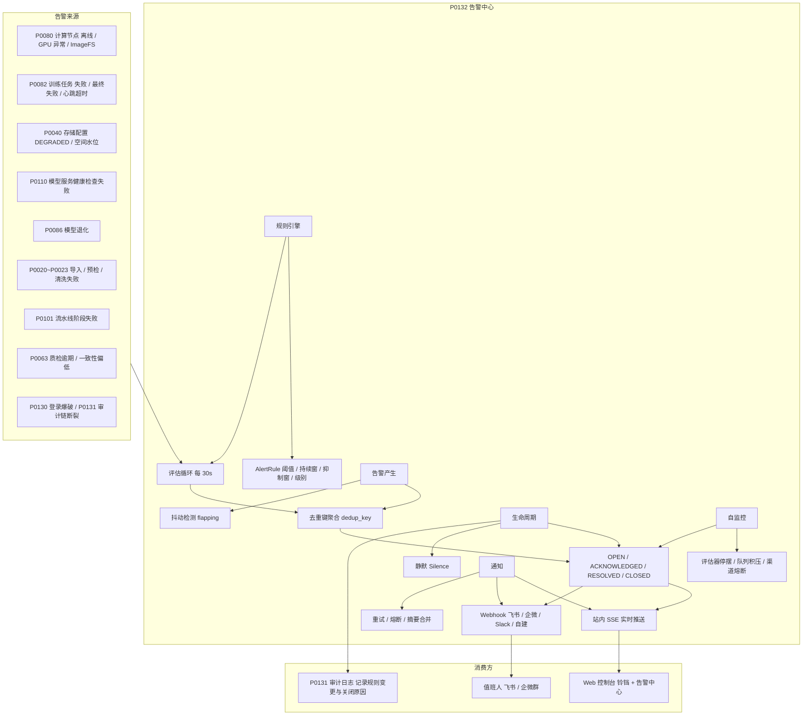
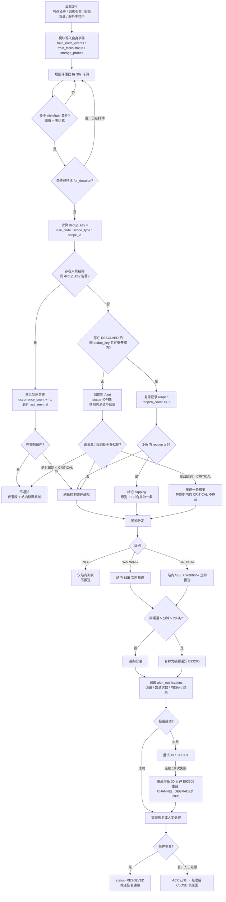
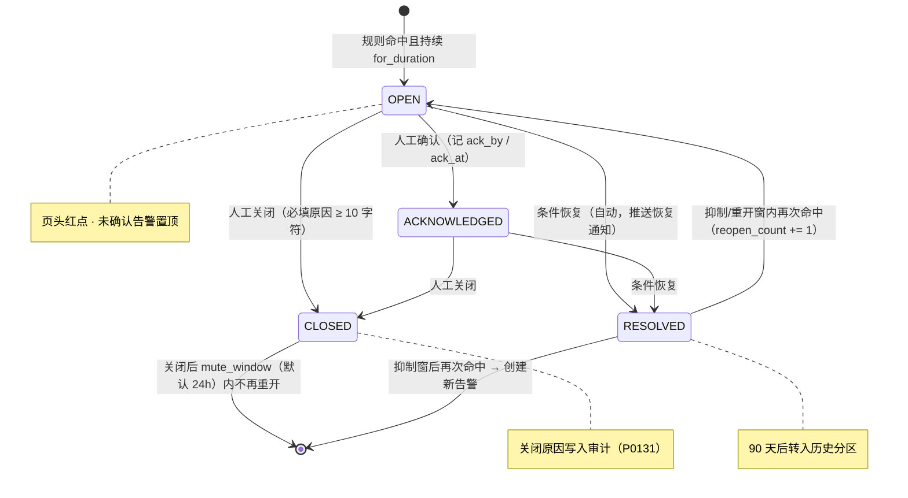
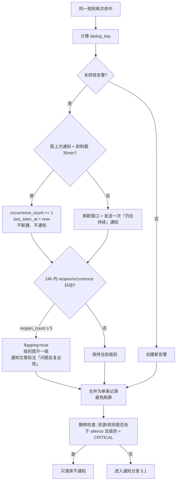
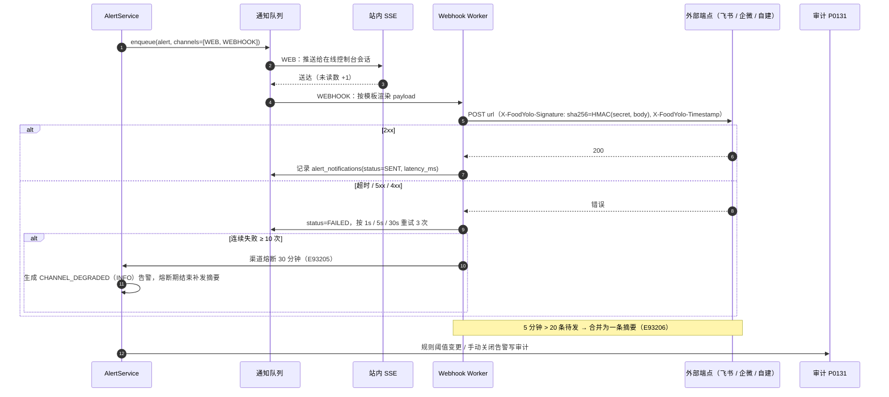
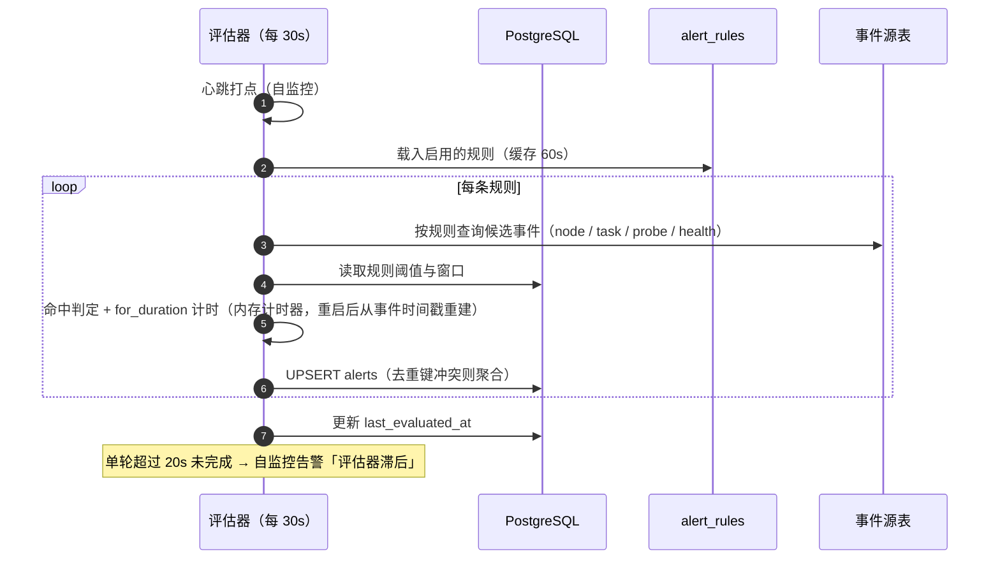
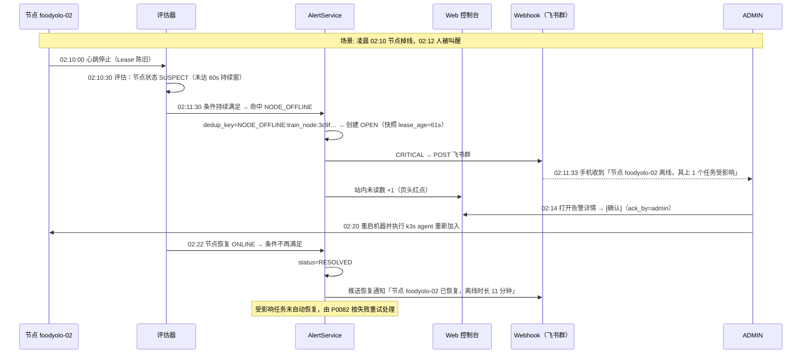

# PRD: P0132_告警中心 (Alert Center)

| 属性 | 内容 |
| :--- | :--- |
| **文档编号** | P0132 |
| **功能模块** | M09_系统管理 |
| **当前版本** | v1.0.0 |
| **文档状态** | Approved |
| **作者** | FoodYolo Team |
| **最后更新** | 2026-10-01 |

---

## 1. 全局说明

> [!IMPORTANT]
> **核心定位**: 单机部署下**唯一的人机异常通道**。设备端出问题没人盯着屏幕，平台必须主动把"节点离线、训练失败、磁盘不足、服务不可用"告诉人，且**不重复轰炸**。告警是"事件经过规则判定后，需要人处理或知晓的子集"，阈值由 `AlertRule` 配置，**不写死在代码里**。

### 名词解释

*   **Event (事件)**: 系统中发生的一次状态变化（如 `TrainNode` 变 `OFFLINE`、`TrainTask` 失败）。全量记录在各模块自有事件表中，**不去重、不通知、允许高基数**。
*   **Alert (告警)**: 事件经 `AlertRule` 判定后产出的对象。有级别、有去重键、有生命周期状态、可被通知与确认。
*   **AlertRule (告警规则)**: 阈值 + 持续时间窗 + 抑制窗 + 级别 + 通知渠道的可配置组合。**规则 → 产生的告警**是一对多。
*   **Severity (级别)**: `INFO` / `WARNING` / `CRITICAL`，决定是否推送与推送渠道。
*   **Dedup Key (去重键)**: `{rule_code}:{scope_type}:{scope_id}`，同一去重键的重复触发**聚合**到同一条 `Alert`，不新建记录、不重复通知。
*   **For Duration (持续时间窗)**: 条件必须持续满足的时长（默认 60s），用于过滤瞬时抖动。
*   **Suppression Window (抑制窗)**: 告警创建后在该窗口内（默认 30 分钟）不再重复通知；窗口内再次触发仅累加 `occurrence_count`。
*   **Reopen (重开)**: 已 `RESOLVED` 的告警在抑制窗内再次命中条件，复用原记录并 `reopen_count += 1`。
*   **Flapping (抖动)**: 同一去重键 24 小时内 `reopen_count ≥ 5`，视为不稳定问题，合并为一条并升级级别。
*   **Silence (静默)**: 对某资源或规则设定静默期（如维护窗口），期内触发只落库不通知。
*   **Channel (渠道)**: `WEB`（站内，SSE 实时推送）与 `WEBHOOK`（出网推送到飞书 / 企业微信 / Slack / 自建系统）。
*   **ACK (确认)**: 人工标记"我看到了，正在处理"，记录 `ack_by` / `ack_at`，**不等于**问题已解决。
*   **Recovery (恢复)**: 触发条件不再满足，告警自动转 `RESOLVED` 并推送一条恢复通知。
*   **Snapshot (快照)**: 告警创建时记录的**实测值**（如 `disk_free_bytes=8.3GB`、`threshold=20GiB`），阈值改变了也能还原当时的判断依据。

### 告警与事件的区别（本模块最容易被误解的边界）

| 维度 | 事件 (Event) | 告警 (Alert) |
| :--- | :--- | :--- |
| 定义 | 系统状态发生了一次变化 | 事件命中规则，需要人知晓/处理 |
| 数量级 | 高（每次状态翻转、每个任务状态迁移） | 低（去重聚合后） |
| 存储 | 各模块自有表（`train_node_events` 等） | `alerts`（本模块） |
| 去重 | 不去重 | 按 `dedup_key` 聚合 |
| 通知 | 从不通知 | 按级别推送 |
| 生命周期 | 无（流水） | `OPEN → ACKNOWLEDGED → RESOLVED / CLOSED` |
| 可确认/关闭 | 否 | 是 |
| 例 | `TrainNode` 每 10s 的心跳与状态字段 | 「节点 foodyolo-02 离线超过 60s」 |

> 一句话：**事件说"发生了什么"，告警说"这件事需要你处理"。** 告警必须能追溯到导致它的事件（`source_event`）。

### 统一异常处理 (E93xxx)

| Code | 场景 | 处理策略 |
| :--- | :--- | :--- |
| `E93201` | 告警写入失败 / 队列积压（> 1,000 条未落库） | 丢弃 `INFO`、保留 `WARNING`/`CRITICAL` 并同步重试；触发自监控告警 |
| `E93202` | 告警引用的事件源已不存在（被监控对象已删除） | 告警保留并把 `source_event` 标注为"源已删除"，不影响确认与关闭 |
| `E93203` | 规则配置非法（阈值越界 / `for_duration` < 评估周期 / 抑制窗 < 恢复判定周期） | 422 + 逐条提示，规则保持原值不落库 |
| `E93204` | Webhook 投递失败（超时 10s / 非 2xx） | 按 1s / 5s / 30s 重试 3 次，记录每次尝试到 `alert_notifications` |
| `E93205` | Webhook 连续失败 ≥ 10 次 | 渠道熔断 30 分钟并生成 `CHANNEL_DEGRADED`（INFO）；熔断期内不再投递，恢复后补发摘要 |
| `E93206` | 通知熔断（同渠道 5 分钟内 > 20 条待发） | 合并为一条摘要通知（含条数与最高级别），防止刷屏 |
| `E93207` | 同一去重键抖动（24h 内 `reopen_count ≥ 5`） | 合并为一条、标记 `flapping=true`、级别提升一级并提示"问题反复出现" |
| `E93208` | 无权限（`ANNOTATOR` / `VIEWER` 执行写操作） | 403 `permission_denied`；列表只读可看（`VIEWER`） |
| `E93209` | 对已 `RESOLVED` / `CLOSED` 的告警设置静默 | 400 + "该告警已终结，无需静默" |
| `E93210` | 手动关闭未填写原因（< 10 字符） | 400 + 校验提示，不关闭告警 |
| `E93211` | 停用 `CRITICAL` 规则 | 需二次确认并写明理由；理由与操作人写入审计（P0131） |
| `E93212` | 未处理告警积压（`OPEN` > 500 条） | 列表顶部提示"建议批量关闭已恢复项"，并触发自监控 INFO 告警 |

---

## 2. 项目背景

### 背景 (Context)
FoodYolo 是单机 Local-First 部署，机器就放在办公室或工位上。真实的使用节奏是：**白天人跑任务，晚上机器自己跑**。训练任务通常几小时到十几小时，流水线一次跑完十阶段；没人会整夜盯着 `docker logs` 或 `nvidia-smi`。

于是最常见的故障模式是"静默失败"：凌晨 2 点训练任务因显存不足 OOM 被杀，早上到工位才发现，白等 8 小时；节点网卡掉了，平台以为节点还在，任务卡在 `DISPATCHED`；磁盘被 `YOLOX_outputs` 和镜像缓存塞满，第二天所有上传全部失败；MinIO 容器重启后没起来，存储配置一直 `DEGRADED`，标注员点开图全是占位图。

这些问题的共同点是：**系统自己知道，但人不知道**。需要的不是更详细的日志，而是一条"该看的时候能叫人、不该看的时候别吵"的通道。

### 问题陈述 (Problem Statement)
1.  **静默失败**: 训练/流水线失败只在任务列表里变成红色，没人主动通知。
2.  **没有感知**: 节点离线、GPU 掉卡、磁盘水位无人监控，直到用户报障。
3.  **重复轰炸**: 朴素实现会在每一轮检测里重复报同一个问题，几十条相同告警淹没真正的新问题。
4.  **告警疲劳**: 阈值写死在代码里，白天在跑任务时的正常波动也算异常，久而久之没人看告警。
5.  **无闭环**: 看到告警后没人记录"是否已处理"，问题反复出现也无从统计。
6.  **信息不足**: 只报"磁盘不足"，不报"哪块盘、剩多少、阈值多少"，无法直接行动。

### 目标与成功指标 (Goals & Success Metrics)
*   **北极星指标**: **需要人介入的异常，从发生到被知晓 < 2 分钟**（`CRITICAL` 走 Webhook，`WARNING` 走站内 SSE）。
*   **次要指标**:
    *   同一问题（同 `dedup_key`）在抑制窗内产生的通知条数 ≤ **1**（去重有效率 > 95%）。
    *   告警规则评估周期 **30s**，从事件发生到告警入库 P95 < **45s**（含 `for_duration`）。
    *   `CRITICAL` 告警 Webhook 投递成功率 > **99%**（含 3 次重试）。
    *   误报率（被人工 `CLOSED` 且原因为"误报"）< **10%**。
    *   告警确认率：`WARNING` 及以上告警 24 小时内被 `ACK` 或 `RESOLVED` 的比例 > **95%**。

### 风险与规避 (Risks & Mitigation)
| 风险 | 影响 | 规避方案 |
| :--- | :--- | :--- |
| 告警风暴（如断网导致一批节点同时离线） | 通知渠道被打爆、人麻木 | 去重键按资源维度 + 通知熔断（E93206）+ 摘要合并 |
| 阈值过松导致漏报 | 真故障被忽略 | 每类规则给推荐默认值并在 UI 显示"该阈值下的历史触发次数"供调参 |
| 阈值过紧导致误报 | 告警疲劳 | `for_duration` 过滤瞬时抖动；抖动检测自动升级而非重复轰炸（E93207） |
| 静默期掩盖真事故 | 维护窗口后才发现严重问题 | 静默期内 `CRITICAL` 仍推送**一条摘要**（可关，默认开） |
| Webhook 出网不可用 | 告警送不出去 | 站内通道始终可用（本地 SSE）；Webhook 失败不影响告警落库与站内展示 |
| 监控自身失效（无人告警） | 故障无人知 | 自监控：规则评估循环停摆、告警队列积压、通知渠道熔断均产生告警；页头常驻"告警系统状态" |
| 规则被随手关掉 | 关键监控缺失 | 关闭 `CRITICAL` 规则需二次确认 + 理由 + 审计；关闭状态在页头展示"N 条关键规则已停用" |
| 告警表无限增长 | DB 膨胀、列表变慢 | `RESOLVED` 告警 90 天后转入历史（分区/归档），列表默认只显示未终结项 |

---

## 3. 价值模型

*   **方案**: `AlertRule`（可配阈值与窗口）+ 周期性评估器（30s 轮询事件）+ 去重聚合与抑制（`dedup_key`）+ 分级通知（站内 SSE / Webhook）+ 状态闭环（ACK / RESOLVE / CLOSE）+ 静默与抖动治理。所有告警带**实测值快照**，阈值改了也能还原判断现场。
*   **目标**:

| 指标 | 现状（无本模块） | 目标 |
| :--- | :--- | :--- |
| 训练失败知晓时间 | 次日发现 | < 2 分钟 |
| 节点离线知晓 | 用户报障 | < 90 秒（60s 持续窗 + 30s 评估） |
| 磁盘耗尽 | 上传失败才发现 | 剩余 < 10% 即预警，< 5% 即告警 |
| 重复通知 | 每轮评估重复一条 | 抑制窗内聚合为 1 条 |
| 处理闭环 | 无 | ACK / 关闭 / 恢复三类状态可统计 |

---

## 4. 项目范围

### 功能结构图


### In Scope (包含范围)
1.  **规则库**：9 类来源、15 条内置规则（见 8.2），阈值 / 持续窗 / 抑制窗 / 级别全部可配。
2.  **告警产生与去重**：`dedup_key` 聚合、`occurrence_count`、`reopen_count`、抖动升级。
3.  **级别与通知策略**：`INFO` / `WARNING` / `CRITICAL` 三级，站点内与 Webhook 双渠道。
4.  **通知治理**：重试（1s/5s/30s）、超时 10s、渠道熔断 30 分钟、5 分钟 > 20 条合并为摘要。
5.  **生命周期闭环**：`ACK`（认领）、`RESOLVED`（条件恢复自动）、`CLOSED`（人工关闭需填原因）。
6.  **静默（Silence）**：按资源或规则设置静默期（维护窗口），最长 7 天。
7.  **列表与详情**：未终结/历史视图、级别与时序筛选、详情含实测值快照与源事件时间线。
8.  **自监控**：评估循环心跳、告警写入队列、通知渠道健康度。
9.  **告警溯源**：每条告警关联 `source_event`，可跳转到对应模块的事件页。

### Out of Scope (不包含范围)
*   **短信 / 电话 / 邮件通知**：单机内网环境，出网能力不保证；只做站内与 Webhook。
*   **告警升级排班（On-call 轮值 / 升级链）**：2~3 人团队无轮值体系，改为"未确认告警置顶 + 页头红点"。
*   **根因分析与关联推断（AIOps）**：不做；只做"同一时间去重键聚合"这一层。
*   **自定义脚本化规则（如 PromQL / 表达式编辑器）**：规则为内置清单 + 参数化，不支持用户写表达式。
*   **GPU 温度 / 风扇 / 功耗的硬件监控**：依赖 DCGM 的具体传感器项不在首版范围（GPU Xid 与显存是例外，已在规则内）。
*   **跨部署实例的集中告警（多机汇总）**：单机产品，每台机器各自告警。
*   **审计日志的实现**：归 P0131；本模块只消费其事件并产生"规则变更 / 告警关闭"的审计。

---

## 5. 业务流程

### 5.1 从异常发生到人被通知（全链路）


### 5.2 告警生命周期状态机


### 5.3 去重与抑制策略


### 5.4 通知投递与熔断


### 5.5 规则评估循环

---

## 6. 用户分析

### 6.1 用户画像 (User Personas)

*   **P1 — 平台管理员 (`ADMIN`)**：告警的主要接收者与规则配置者。
    *   **职责**: 盯住机器与存储，处理节点、磁盘、存储、服务类告警，调阈值。
    *   **核心诉求**: "半夜训练挂了要能叫醒我；白天正常的显存波动别吵我。"
    *   **痛点**: 一个晚上几十条重复告警后干脆静音全部通知，然后真出事也不知道。

*   **P2 — 算法 / 训练工程师 (`TRAINER`)**：**任务类告警**的接收者。
    *   **职责**: 关注自己提交的训练与流水线任务。
    *   **核心诉求**: "我提交的任务失败了，告诉我失败原因（OOM 还是代码报错），别只给一个红叉。"
    *   **痛点**: 页面里任务变红但不知何时发生、为何发生，需要自己翻日志。

*   **P3 — 只读访客 (`VIEWER`)**：**只读**看板用户。
    *   **职责**: 了解平台当前是否健康。
    *   **核心诉求**: "一眼看出有没有正在发生的问题。"
    *   **痛点**: 无（但不得有确认 / 关闭 / 改规则的权限）。

*   **P4 — 标注员 (`ANNOTATOR`)**：**无权限**（其关心的返工逾期由其任务列表体现）。

### 6.2 用户链路图 (User Journey Map)


---

## 7. 功能需求

### M09.F01 告警规则与来源管理 (Alert Rules & Sources)
*   **用户故事**: 作为管理员，我希望集中看到每类异常由哪条规则覆盖、阈值是多少，并能按本机实际负载调整，以便告警既不漏报也不吵人。

*   **逻辑与业务规则**:
    *   **内置规则库**: 15 条内置规则覆盖 9 类来源（见 8.2）；规则**只能改参数与启停**，不能新增自定义表达式。
    *   **可配参数**: `threshold` / `for_duration` / `suppression_window` / `severity` / `channels` / `enabled`。
    *   **默认值**: 规则出厂即带推荐默认值并在 UI 展示"近 30 天该规则的触发次数"，供调参参考。
    *   **硬约束**: `for_duration ≥ 30s`（评估周期）、`suppression_window > for_duration`，否则 `E93203`。
    *   **启停保护**: 停用 `CRITICAL` 规则需二次确认 + 理由（≥ 10 字符），并写审计（`E93211`）；页头常驻"N 条关键规则已停用"。
    *   **后置条件**: 规则变更写审计 `ALERT_RULE.UPDATE`；不回溯已产生的告警。
*   **验收标准**:
    ```gherkin
    场景: 调整磁盘阈值并即时生效
      Given 规则 DISK_LOW 的阈值为「剩余 < 10% 或 < 20GiB」
      When 管理员改为「剩余 < 15% 或 < 30GiB」并保存
      Then 下一轮评估（≤30s）按新阈值判定
      And 审计写入 ALERT_RULE.UPDATE（含 before/after）

    场景: 停用关键规则需确认
      Given 规则 NODE_OFFLINE 的级别为 CRITICAL
      When 管理员点击 [停用] 且未填写理由
      Then 拒绝停用并提示需填写理由（E93211）
      And 填写理由后停用，页头显示「1 条关键规则已停用」
    ```

*   **边界情况与异常处理**:

    | 场景 | 处理 |
    | :--- | :--- |
    | 阈值改动后历史告警受影响 | 不变；每条告警保存触发时的阈值快照，历史记录仍可解释 |
    | 所有规则被停用 | 允许但页头展示醒目提示；自监控始终启用且不可停用 |
    | 规则指向的事件源不存在（如节点已移除） | 规则保留但标记"当前无匹配资源"，不产生告警 |
    | 阈值被设成极端值（如 0%） | `E93203` 拒绝：阈值必须落在规则声明的 `[min, max]` 范围内 |

### M09.F02 去重、聚合与抑制 (Dedup, Aggregation & Suppression)
*   **用户故事**: 作为值班人，我希望同一个问题只提醒我一次，以便新出现的、真正不同的问题不会被淹没。

*   **逻辑与业务规则**:
    *   **去重键**: `dedup_key = {rule_code}:{scope_type}:{scope_id}`，`UNIQUE` 约束仅作用于未终结（`OPEN` / `ACKNOWLEDGED`）状态。
    *   **聚合**: 同键重复触发只更新 `occurrence_count` / `last_seen_at` / `last_value`，不新建记录。
    *   **抑制窗**: 创建后 `suppression_window`（默认 30 分钟，可配 5~1440）内不再通知；窗口过后若仍在持续，发送一条"仍在持续"通知。
    *   **重开**: `RESOLVED` 后 `reopen_window`（默认 30 分钟）内再次命中 → 复用原记录并 `reopen_count += 1`；超出窗口创建新告警。
    *   **抖动治理**: 24 小时内 `reopen_count ≥ 5` → `flapping = true`，级别提升一级、合并为一条，并在通知文案标注"问题反复出现"（`E93207`）。
    *   **关闭静音**: `CLOSED` 的告警在 `mute_window`（默认 24 小时）内同键不再重开（避免"关掉又立刻回来"）。
    *   **后置条件**: 聚合与重开均更新 `alerts` 单行，不产生新记录。
*   **验收标准**:
    ```gherkin
    场景: 抑制窗内不重复轰炸
      Given 磁盘水位持续低于阈值，已产生 1 条 DISK_LOW 告警
      When 评估器连续 10 轮（每 30s）再次命中
      Then 仍只有 1 条告警，occurrence_count=11
      And 仅发送过 1 条通知

    场景: 反复抖动升级
      Given 同一 dedup_key 的告警在 24 小时内 reopen 5 次
      When 第 5 次重开
      Then 该告警 flapping=true 且级别由 WARNING 提升为 CRITICAL
      And 通知文案包含「问题反复出现（24h 内 5 次）」
    ```

*   **边界情况与异常处理**:

    | 场景 | 处理 |
    | :--- | :--- |
    | 批量节点同时离线（断网） | 每节点一条告警（不同 `scope_id`），但触发通知熔断合并为一条摘要（E93206） |
    | 告警未终结时资源被删除 | 保留告警，`source_event` 标注"源已删除"（E93202），允许人工关闭 |
    | 服务重启导致 for_duration 计时丢失 | 从事件时间戳重建计时（不依赖内存计数），避免重启即告警 |
    | 抑制窗被设得过长（> 24h） | `E93203` 拒绝：抑制窗上限 1440 分钟 |
    | 同键 `RESOLVED` 后长期未再触发 | 90 天后转入历史分区，不再参与重开判定 |

### M09.F03 告警级别与升级 (Severity & Escalation)
*   **用户故事**: 作为管理员，我希望只有真正要紧的事才会打断我，以便通知渠道保持可信。

*   **逻辑与业务规则**:
    *   **级别语义**:
        *   `INFO`：状态性告知（恢复通知、渠道熔断、规则停用）。**只进列表，不推送。**
        *   `WARNING`：需要关注但不紧急（单次训练失败、磁盘 < 10%、模型退化、返工逾期）。**站内实时推送。**
        *   `CRITICAL`：服务不可用或数据风险（节点离线、存储 `DEGRADED`、任务最终失败、磁盘 < 5%、推理服务不可用、审计链断裂）。**站内 + Webhook 立即推送。**
    *   **升级规则**: 抖动自动 +1 级（`E93207`）；`WARNING` 告警持续未确认超过 `escalate_after`（默认 2 小时，可配）→ 提升为 `CRITICAL` 并推送一次（"长时间未处理"）。
    *   **降级**: 不做自动降级；级别只能由规则变更或人工调整（人工调整写审计）。
    *   **未确认置顶**: 未 `ACK` 的告警在列表置顶；页头铃铛显示未读数，`CRITICAL` 显示红色并常驻直到被处理。
    *   **后置条件**: 级别变化写 `alerts.severity_history`（JSONB 数组：时间 / 原级别 / 新级别 / 原因）。
*   **验收标准**:
    ```gherkin
    场景: 长时间未确认自动升级
      Given 一条 WARNING 告警创建于 2 小时前且未被确认
      When 评估器检查未确认时长
      Then 级别提升为 CRITICAL，severity_history 追加一条记录
      And 通过 Webhook 推送一次「长时间未处理」通知

    场景: INFO 不打扰
      Given 规则 CHANNEL_DEGRADED 的级别为 INFO
      When 该告警产生
      Then 仅出现在告警列表中，未读数不增加，无任何推送
    ```

*   **边界情况与异常处理**:

    | 场景 | 处理 |
    | :--- | :--- |
    | 未确认告警在一夜之间堆积 | 仅最高级别与摘要推送；列表按级别 + 时间排序，提供"批量确认" |
    | 人工把 CRITICAL 降为 INFO 以图清净 | 允许但需理由并写审计；自监控规则（评估器停摆 / 渠道熔断）**不允许**修改级别 |
    | 级别提升后又恢复 | 恢复通知按**提升后**级别发送，避免漏报 |
    | 同一告警反复升/降 | 升级只在状态变化或超时时发生，不随每轮评估反复写入 |

### M09.F04 通知渠道（站内 + Webhook）(Notification Channels)
*   **用户故事**: 作为管理员，我希望关键告警能推到手机上的飞书群，以便不在工位也能第一时间知道。

*   **逻辑与业务规则**:
    *   **站内（WEB）**: 顶栏铃铛 + 未读数，通过 **SSE** 长连接实时推送（单机无外网依赖）；断线自动重连并从 `last_event_id` 补齐。
    *   **Webhook**: 支持通用 JSON 与三种预置模板（飞书 / 企业微信 / Slack）；配置 `url` / `secret`(可选) / `min_severity` / `enabled`；默认只推 `CRITICAL`。
    *   **签名**: `X-FoodYolo-Signature: sha256=<HMAC-SHA256(secret, body)>` 与 `X-FoodYolo-Timestamp`，接收方可校验与防重放。
    *   **投递策略**: 超时 10s；失败按 1s / 5s / 30s 重试 3 次；每次尝试记入 `alert_notifications`。
    *   **熔断**: 连续 10 次失败 → 渠道熔断 30 分钟（`E93205`）并生成 `CHANNEL_DEGRADED`（INFO）告警；恢复后补发期间摘要。
    *   **摘要合并**: 同渠道 5 分钟内待发 > 20 条 → 合并为一条摘要（`E93206`），含条数、最高级别与 Top-5 标题。
    *   **后置条件**: 每次投递尝试都有记录；站内投递不记录失败重试（SSE 断线由客户端补齐）。
*   **验收标准**:
    ```gherkin
    场景: Webhook 重试与熔断
      Given Webhook 端点返回 500
      When 一条 CRITICAL 告警触发投递
      Then 按 1s / 5s / 30s 重试共 3 次，alert_notifications 记录 4 条尝试
      And 连续 10 次失败后渠道熔断 30 分钟并生成 INFO 告警

    场景: 站内推送与已读
      Given 控制台已建立 SSE 连接
      When 一条 WARNING 告警产生
      Then 铃铛未读数 +1 且无需刷新页面
      And 打开告警中心后未读数清零
    ```

*   **边界情况与异常处理**:

    | 场景 | 处理 |
    | :--- | :--- |
    | 内网无外网出口 | Webhook 不可达；站内通道不受影响，自监控提示"Webhook 渠道不可用" |
    | 飞书自定义机器人限流 | 命中 429 时按响应头退避重试，仍失败则计入熔断计数 |
    | secret 泄露 | 支持一键轮换 secret；轮换后旧签名立即失效 |
    | 通知内容包含敏感信息 | 模板只渲染标题、级别、资源名、实测值，**不含**凭据与存储路径 |
    | 同一告警同时命中 Web 与 Webhook | 双渠道并行投递，互不阻塞（各自独立重试） |

### M09.F05 确认、关闭与静默 (ACK, Close & Silence)
*   **用户故事**: 作为值班人，我希望标明"我看到了、我处理了"，以便告警列表反映真实状态，而不是一直红着。

*   **逻辑与业务规则**:
    *   **ACK**: 记录 `ack_by` / `ack_at`；`ACK` 后告警仍保持 `ACKNOWLEDGED` 直到条件恢复或人工关闭；同 `dedup_key` 的再次触发**不**回退到 `OPEN`。
    *   **RESOLVED**: 条件恢复后**自动**转 `RESOLVED` 并推送恢复通知（级别随告警级别）。
    *   **CLOSE**: 人工关闭，必须填写原因（≥ 10 字符），原因分类可选 `FALSE_POSITIVE` / `HANDLED` / `IGNORED` / `DUPLICATE`；写入审计。
    *   **静默**: 对**资源**（如某节点、某存储配置）或**规则**设置 `silenced_until`（≤ 7 天）与理由；期内触发只落库不通知；静默不影响告警状态（仍可 `OPEN`）。
    *   **静默例外**: 静默期内 `CRITICAL` 级别仍推送**一条摘要**（可在配置里关闭，默认开启），避免维护窗口掩盖真事故。
    *   **后置条件**: 关闭原因与静默设置写审计；`E93209` 拒绝对已终结告警设置静默。
*   **验收标准**:
    ```gherkin
    场景: 确认后不因反复触发回退
      Given 一条已 ACKNOWLEDGED 的 DISK_LOW 告警
      When 下一轮评估再次命中同一 dedup_key
      Then 状态仍为 ACKNOWLEDGED，仅 occurrence_count 递增

    场景: 静默期内 CRITICAL 仍摘要提醒
      Given 节点 foodyolo-02 处于 24 小时静默期（维护窗口）
      When 该节点离线并命中 NODE_OFFLINE（CRITICAL）
      Then 不发送逐条通知，但发送一条含级别与资源名的摘要
      And 告警本身正常创建为 OPEN 状态

    场景: 关闭必须填原因
      Given 一条 OPEN 告警
      When 点击 [关闭] 且原因少于 10 字符
      Then 返回 400 E93210，告警保持 OPEN
    ```

*   **边界情况与异常处理**:

    | 场景 | 处理 |
    | :--- | :--- |
    | 静默期结束仍有问题 | 静默到期后第一轮评估即按正常规则通知（不追溯补发） |
    | 多人同时 ACK | 后到者覆盖 `ack_by`；前端提示"已由 X 确认"，不报错 |
    | 关闭后发现是误关 | 提供 `[重新打开]`（仅 ADMIN），重置为 `OPEN` 并写审计 |
    | 对规则整体静默 | 允许（如"训练类告警静默到明天早上"），页头显示"1 条规则静默中" |
    | 恢复通知与关闭竞争 | 已 `CLOSED` 的告警不再发送恢复通知（避免"已关闭却又报恢复"） |

### M09.F06 告警列表、详情与溯源 (List, Detail & Traceability)
*   **用户故事**: 作为管理员，我希望看到"什么时候、哪台机器、实测值多少、阈值多少"，以便不用猜就能动手。

*   **逻辑与业务规则**:
    *   **列表视图**: 默认"未终结"（`OPEN` + `ACKNOWLEDGED`），可切"全部 / 历史"；列含级别、规则、资源、首次/最近时间、次数、状态、确认人。
    *   **筛选**: 级别、状态、规则、资源、时间范围、是否静默中、是否抖动（`flapping`）。
    *   **详情内容**: 标题与描述、`dedup_key`、**实测值与阈值快照**、首次/最近触发时间、`occurrence_count` / `reopen_count`、`severity_history`、静默信息、通知投递记录（渠道 / 尝试 / 响应码）、`source_event` 跳转（如节点详情页、任务详情页）、处理记录（ACK / 关闭 / 恢复时间线）。
    *   **批量操作**: 批量确认 / 批量关闭（同原因），仅对同级别告警生效。
    *   **权限**: `ADMIN` / `TRAINER` 可确认与关闭（`TRAINER` 仅限训练与流水线类告警）；`VIEWER` 只读；`ANNOTATOR` 无权（`E93208`）。
    *   **后置条件**: 纯读不产生审计；写操作（ACK / CLOSE）写审计。
*   **验收标准**:
    ```gherkin
    场景: 详情包含可行动信息
      Given 一条 DISK_LOW 告警
      When 打开详情
      Then 展示 disk_free_bytes=8.3GB、total=100GB、threshold=「<10% 或 <20GiB」
      And 展示近 30 天同类告警 4 次，其中 2 次已恢复
      And 提供跳转到存储配置页的链接

    场景: 只读用户不能写
      Given 用户角色为 VIEWER
      When 尝试调用 POST /alerts/{id}/ack
      Then 返回 403 E93208
      And 列表页不渲染 [确认] 与 [关闭] 按钮
    ```

*   **边界情况与异常处理**:

    | 场景 | 处理 |
    | :--- | :--- |
    | 告警引用的资源已被删除 | 展示名称快照并标注"资源已删除"，只读不可跳转 |
    | 历史告警量大 | 默认只查最近 30 天；> 90 天的 `RESOLVED` 数据转历史分区，查询自动提示 |
    | 通知投递记录过多 | 详情默认展示最近 10 次尝试，"查看全部"再加载 |
    | 时间线跨重启 | 时间线基于 `alerts` 字段与投递记录重建，不依赖内存状态 |
    | 同一资源的多条告警 | 详情页侧栏提供"该资源的其他告警"列表，便于判断关联性 |

### M09.F07 自监控与告警系统健康 (Self-Monitoring)
*   **用户故事**: 作为管理员，我希望知道"告警系统自己是不是还活着"，以便不会在无人告警的情况下蒙在鼓里。

*   **逻辑与业务规则**:
    *   **自监控项**（本身即告警，规则不可停用、级别不可修改）:
        1. `EVALUATOR_STALLED`：评估循环超过 **20s** 未完成或心跳缺失 > 90s → `CRITICAL`。
        2. `ALERT_WRITE_BACKLOG`：告警写入队列 > 1,000 条 → `WARNING`。
        3. `CHANNEL_DEGRADED`：任一渠道熔断 → `INFO`。
        4. `ALERT_BACKLOG`：未终结告警 > 500 条 → `INFO`（提示清理）。
        5. `RULE_DISABLED`：存在被停用的 `CRITICAL` 规则 → `WARNING`（每 24 小时提醒一次）。
    *   **状态可见**: 页头常驻"告警系统状态"徽标（正常 / 降级 / 停摆）与最近一次评估时间；停摆时列表顶部红色横幅。
    *   **降级行为**: 评估器停摆期间，站内推送仍可用（由事件驱动的高优先级检查保证关键事件即时评估，见 8.3）。
    *   **后置条件**: 自监控告警与普通告警同一套生命周期，同样可被 ACK / 关闭。
*   **验收标准**:
    ```gherkin
    场景: 评估器停摆被发现
      Given 评估循环因异常连续 90 秒未完成
      When 自监控检查执行
      Then 生成 EVALUATOR_STALLED（CRITICAL）告警并推送
      And 页头徽标变为「停摆」，列表顶部出现红色横幅

    场景: 关键规则被停用提醒
      Given NODE_OFFLINE 规则处于停用状态
      When 自监控每日检查
      Then 生成 RULE_DISABLED（WARNING）告警，24 小时内不重复提醒
    ```

*   **边界情况与异常处理**:

    | 场景 | 处理 |
    | :--- | :--- |
    | 评估器与告警服务同进程崩溃 | 依赖进程级重启（systemd / Docker restart 策略）；重启后从事件时间戳重建并补发未处理告警 |
    | 自监控告警自己写不进去 | 落本地文件 `alert-fallback.log` 并在下次启动时补录，同时页头展示"存在未落库告警" |
    | 用户关闭自监控告警 | 允许（避免噪声），但下一个检查周期若条件仍成立会重开 |
    | 数据库不可用 | 评估器读不到事件；恢复后按 `last_evaluated_at` 回补一个窗口（最多回溯 1 小时） |
---

## 8. 技术架构与数据模型

### 8.1 数据实体

#### Table: `alerts`（Alert）

| 字段名 | 类型 | 必填 | 说明 | 约束 |
| :--- | :--- | :--- | :--- | :--- |
| `id` | UUID | Y | 主键 | PK |
| `rule_code` | String(32) | Y | 规则码 | 见 8.2 |
| `severity` | Enum | Y | 当前级别 | `INFO` / `WARNING` / `CRITICAL` |
| `status` | Enum | Y | 生命周期 | `OPEN` / `ACKNOWLEDGED` / `RESOLVED` / `CLOSED` |
| `dedup_key` | String(128) | Y | 去重键 | `{rule_code}:{scope_type}:{scope_id}` |
| `scope_type` / `scope_id` | String(32) / UUID | Y | 作用对象 | 如 `train_node` / `storage_config` / `train_task` |
| `scope_name` | String(128) | N | 对象名称快照 | 对象被删后仍可读 |
| `title` / `message` | String(128) / String(1024) | Y | 标题与描述 | 描述含可行动信息 |
| `value_snapshot_json` | JSONB | Y | **实测值 + 阈值快照** | 如 `{measured:8.3GB, threshold:"<10% 或 <20GiB"}` |
| `first_seen_at` / `last_seen_at` | Timestamptz | Y | 首次 / 最近触发 | |
| `occurrence_count` | Int | Y | 命中次数 | default 1 |
| `reopen_count` | Int | Y | 重开次数 | default 0 |
| `flapping` | Boolean | Y | 是否抖动 | `reopen_count ≥ 5`（24h）时置 true |
| `severity_history` | JSONB | N | 级别变化史 | `[{at, from, to, reason}]` |
| `ack_by` / `ack_at` | UUID / Timestamptz | N | 确认人与时间 | |
| `resolved_at` | Timestamptz | N | 自动恢复时间 | |
| `closed_by` / `closed_at` / `close_reason` / `close_reason_code` | UUID / Timestamptz / String(255) / Enum | N | 关闭信息 | `FALSE_POSITIVE`/`HANDLED`/`IGNORED`/`DUPLICATE` |
| `silenced_until` / `silence_reason` | Timestamptz / String(255) | N | 静默信息 | 静默期内不通知 |
| `source_event_type` / `source_event_id` | String(32) / String(64) | N | 溯源事件 | 可跳转到模块事件页 |
| `first_notified_at` / `last_notified_at` | Timestamptz | N | 通知时间 | 抑制窗的判定依据 |
| `created_at` / `updated_at` / `deleted_at` | Timestamptz | Y/N | 通用字段 | `RESOLVED` 90 天后转历史 |

#### Table: `alert_rules`（AlertRule）

| 字段名 | 类型 | 必填 | 说明 | 约束 |
| :--- | :--- | :--- | :--- | :--- |
| `id` | UUID | Y | 主键 | PK |
| `code` | String(32) | Y | 规则码 | UNIQUE，内置清单固定 |
| `name` / `description` | String(64) / String(255) | Y | 名称与说明 | |
| `source_module` | String(16) | Y | 来源模块 | 如 `P0080` |
| `scope_type` | String(32) | Y | 作用对象类型 | 决定去重键维度 |
| `enabled` | Boolean | Y | 是否启用 | default true；`is_system` 规则不可停用 |
| `severity` | Enum | Y | 级别 | `INFO` / `WARNING` / `CRITICAL` |
| `threshold_json` | JSONB | Y | 阈值参数 | 如 `{free_ratio:0.10, free_bytes:20GiB}` |
| `for_duration_sec` | Int | Y | 持续时间窗 | ≥ 30（评估周期），default 60 |
| `suppression_window_sec` | Int | Y | 抑制窗 | 300~86400，default 1800 |
| `reopen_window_sec` | Int | Y | 重开窗 | default 1800 |
| `escalate_after_sec` | Int | N | 未确认升级时长 | 0 表示不升级，default 7200（仅 `WARNING`） |
| `channels` | JSONB | Y | 通知渠道 | 如 `["WEB","WEBHOOK"]` |
| `is_system` | Boolean | Y | 自监控规则 | true 时不可停用、级别不可改 |
| `updated_by` | UUID | N | 最后修改人 | FK → `users.id` |
| `created_at` / `updated_at` / `deleted_at` | Timestamptz | Y/N | 通用字段 | |

#### Table: `alert_notifications`（AlertNotification，投递尝试记录）

| 字段名 | 类型 | 必填 | 说明 | 约束 |
| :--- | :--- | :--- | :--- | :--- |
| `id` | UUID | Y | 主键 | PK |
| `alert_id` | UUID | Y | 所属告警 | FK → `alerts.id`（1:N） |
| `channel` | Enum | Y | 渠道 | `WEB` / `WEBHOOK` |
| `target` | String(512) | N | 目标（Webhook URL 的 host+path，**不含 secret**） | 站内为 NULL |
| `attempt` | Int | Y | 第几次尝试 | 1 起 |
| `status` | Enum | Y | 投递结果 | `PENDING` / `SENT` / `FAILED` / `MERGED`（被摘要合并） / `SKIPPED`（熔断期内） |
| `response_code` | Int | N | HTTP 状态码 | Webhook 专用 |
| `error` | String(255) | N | 错误摘要 | 不记录响应体 |
| `latency_ms` | Int | N | 耗时 | |
| `payload_digest` | String(64) | N | payload 内容摘要 | 便于排查投递内容，不落明文 |
| `created_at` | Timestamptz | Y | 尝试时间 | |

### 8.2 内置规则清单（15 条 + 5 条自监控）

| 规则码 | 来源 | 默认触发条件 | 级别 | 持续窗 | 抑制窗 | 自动恢复 |
| :--- | :--- | :--- | :--- | :--- | :--- | :--- |
| `NODE_OFFLINE` | P0080 | Node `Ready≠True` 或 Lease 陈旧 > 60s | CRITICAL | 60s | 30min | 是 |
| `NODE_UNHEALTHY` | P0080 | GPU Xid ≠ 0 / device-plugin 非 Running / ImageFS < 20GiB 或 < 10% | CRITICAL | 60s | 30min | 是 |
| `GPU_VRAM_PRESSURE` | P0080 | 节点空闲显存 < 1GiB 或 < 10% | WARNING | 5min | 30min | 是 |
| `TRAIN_TASK_OOM` | P0082 | 任务 attempt 以 `OOMKilled` 结束 | WARNING | 0 | 30min | 是（任务级） |
| `TRAIN_TASK_FAILED` | P0082 | 单次 attempt 失败（非取消、非最终失败） | WARNING | 0 | 30min | 是 |
| `TRAIN_TASK_FINAL_FAILED` | P0082 | 重试耗尽 → `FINAL_FAILED` | **CRITICAL** | 0 | 15min | 否（需人工） |
| `TRAIN_TASK_STALLED` | P0082 看门狗 | 心跳缺失 > 10min | **CRITICAL** | 0 | 15min | 是 |
| `DISK_LOW` | P0040 / P0080 | 分区或桶剩余 < 10% 或 < 20GiB | WARNING | 5min | 60min | 是 |
| `DISK_CRITICAL` | P0040 / P0080 | 剩余 < 5% 或 < 5GiB | **CRITICAL** | 1min | 30min | 是 |
| `STORAGE_UNAVAILABLE` | P0040 | 存储配置连续 2 次探测失败 → `DEGRADED` | **CRITICAL** | 0 | 30min | 是 |
| `SERVICE_UNAVAILABLE` | P0110 | 模型服务健康检查连续 3 次失败 | **CRITICAL** | 0 | 15min | 是 |
| `MODEL_REGRESSION` | P0086 | 评估 `mAP50-95` 相对基线 Δ ≤ −0.05（可配） | WARNING | 0 | 24h | 否 |
| `JOB_FAILED` | P0020~P0023 / P0101 | `ImportTask` / `PipelineRun` 失败 | WARNING | 0 | 60min | 否 |
| `QC_REWORK_OVERDUE` | P0063 | 返工项超过时限未提交 | WARNING | 0 | 24h | 是 |
| `AUTH_BRUTEFORCE` | P0130 | 同 IP 10 分钟内登录失败 ≥ 20 次 | WARNING | 0 | 60min | 是 |
| `AUDIT_WRITE_DEGRADED` | P0131 | 审计队列满或 Worker 停滞 | WARNING | 0 | 30min | 是 |
| `AUDIT_INTEGRITY_BROKEN` | P0131 | 哈希链校验失败 | **CRITICAL** | 0 | 0（每次） | 否 |

**自监控规则**（`is_system = true`，不可停用、级别不可改）

| 规则码 | 触发条件 | 级别 |
| :--- | :--- | :--- |
| `EVALUATOR_STALLED` | 评估循环单轮 > 20s 或心跳缺失 > 90s | CRITICAL |
| `ALERT_WRITE_BACKLOG` | 告警写入队列 > 1,000 条 | WARNING |
| `CHANNEL_DEGRADED` | 任一通知渠道熔断 | INFO |
| `ALERT_BACKLOG` | 未终结告警 > 500 条 | INFO |
| `RULE_DISABLED` | 存在被停用的 `CRITICAL` 规则（每 24h 提醒一次） | WARNING |

### 8.3 关键实现约定

*   **去重唯一性**: `CREATE UNIQUE INDEX ON alerts(dedup_key) WHERE status IN ('OPEN','ACKNOWLEDGED')` —— 从数据库层保证"同一问题只有一条未终结告警"。
*   **`for_duration` 重建**: 持续窗计时从**事件的时间戳**推导（记录 `first_seen_at` 候选点于内存 + 事件表），服务重启不丢计时、不误报也不漏报。
*   **事件驱动的即时评估**: 关键事件（任务终态、节点状态翻转、存储探测失败）写库后立即触发一次**定向评估**（不等 30s 周期），把 `CRITICAL` 的感知时间压到 5s 内。
*   **静默优先级**: 资源级静默 > 规则级静默 > 全局无静默；`CRITICAL` 在静默期内仍发摘要（可配 `silence_allow_critical=true`）。
*   **通知内容最小化**: 模板只渲染标题、级别、资源名、实测值与阈值；**不含**存储路径、凭据、Token。
*   **渠道配置**: Webhook 配置存于系统设置（`webhook_url` / `secret_cipher` / `min_severity` / `enabled`），secret 加密存储（复用 P0040 的 AES-256-GCM 方案）。
*   **索引**: `alerts(status, severity, last_seen_at DESC)`、`alerts(dedup_key) UNIQUE partial`、`alerts(scope_type, scope_id)`、`alert_notifications(alert_id, created_at DESC)`。
*   **容量估算**: 2~3 人团队日增告警 < 50 条；`RESOLVED` 90 天后归档，年增量 < 10MB。

---

## 9. UI/UX 规格说明

### 9.1 告警中心列表
```text
+-------------------------------------------------------------------------------------------------+
|  系统管理 > 告警中心        [规则配置] [静默管理]  🔔 未读 3 · 告警系统状态: ● 正常             |
+-------------------------------------------------------------------------------------------------+
|  视图 (•) 未终结 ( ) 全部 ( ) 历史    级别 [全部▾] 状态 [全部▾] 规则 [全部▾] 资源 [______]      |
|  时间 [ 2026-09-24 ] ~ [ 2026-10-01 ]   [ ] 仅看抖动   [ ] 仅看静默中        [批量确认] [批量关闭]|
+-------------------------------------------------------------------------------------------------+
|  ● CRITICAL  TRAIN_TASK_FINAL_FAILED                                     OPEN      [确认][关闭] |
|    task_42「包装-日期-v3 训练」重试 3 次后最终失败（OOMKilled ×3）                             |
|    节点 foodyolo-01 · 首次 10-01 03:12 · 最近 03:41 · 触发 4 次 · 未确认 2 小时 ⚠ 已超时升级     |
|  ---------------------------------------------------------------------------------------------- |
|  ● CRITICAL  NODE_OFFLINE                                   ACKNOWLEDGED(admin)   [关闭]         |
|    node foodyolo-02 离线 61s → 已离线 11 分钟 · 其上 1 个任务受影响                              |
|    首次 10-01 02:11 · 最近 02:22 · 触发 1 次 · [查看节点]                                       |
|  ---------------------------------------------------------------------------------------------- |
|  ● WARNING   DISK_LOW                                                 OPEN · 静默中  🔕 [确认]    |
|    存储「本地 NVMe」剩余 9.2% (184GB/2TB) < 阈值 10% · 建议清理 YOLOX_outputs 与镜像缓存        |
|    首次 09-30 21:05 · 最近 10-01 08:00 · 触发 22 次 · [查看存储]                                |
|  ---------------------------------------------------------------------------------------------- |
|  ○ INFO      CHANNEL_DEGRADED                                          OPEN         [关闭]        |
|    Webhook 渠道连续失败 10 次，已熔断 30 分钟（预计 08:31 恢复）                                 |
+-------------------------------------------------------------------------------------------------+
|  未终结 4 条（CRITICAL 2 · WARNING 1 · INFO 1）· 近 30 天已恢复 37 条 · 平均恢复耗时 14 分钟      |
+-------------------------------------------------------------------------------------------------+
```

### 9.2 告警详情与时间线
```text
+------------------------------------------------------------------+  +----------------------------+
|  NODE_OFFLINE                          [CRITICAL]  [确认] [关闭]  |  |  该资源的其他告警          |
+------------------------------------------------------------------+  |  · GPU_VRAM_PRESSURE 09-28 |
|  状态  ACKNOWLEDGED（admin 于 02:14 确认）                        |  |    WARNING · RESOLVED      |
|  去重键  NODE_OFFLINE:train_node:3c9f-…-a12b                      |  |  · NODE_UNHEALTHY 09-22   |
|  作用对象  train_node「foodyolo-02」  [查看节点详情 →]             |  |    CRITICAL · CLOSED       |
+------------------------------------------------------------------+  +----------------------------+
|  实测值与阈值快照                                                 |
|  ------------------------------------------------------------------|
|  lease_age_sec        61          > 60          （触发）           |
|  ready_condition      Unknown     ≠ True        （触发）           |
|  running_tasks        1           受影响任务数                     |
+-------------------------------------------------------------------+
|  时间线                                                           |
|  ------------------------------------------------------------------|
|  02:10:00  节点心跳停止（事件 train_node_events #88121）            |
|  02:11:30  告警创建 OPEN（持续窗 60s 满足）· Webhook 已投递 ✅      |
|  02:11:31  站内推送（未读数 +1）                                   |
|  02:14:07  admin 确认（ACKNOWLEDGED）                              |
|  02:22:10  节点恢复 ONLINE → RESOLVED · 恢复通知已投递 ✅          |
|  恢复耗时  11 分 40 秒                                             |
+-------------------------------------------------------------------+
|  通知记录 (2)  WEBHOOK https://open.feishu.cn/… 200 · 142ms        |
|                WEB   站内 SSE · 送达                                |
+-------------------------------------------------------------------+
```

### 9.3 规则配置
```text
+-------------------------------------------------------------------------------------------+
|  规则配置                                          ⚠ 1 条关键规则已停用  [恢复默认值]      |
+-------------------------------------------------------------------------------------------+
|  规则                       级别      阈值 / 窗口                       通知渠道    启用   |
|  ---------------------------------------------------------------------------------------- |
|  NODE_OFFLINE               CRITICAL  持续 60s · 抑制 30min · 升级 2h    WEB+HOOK    [✓]  |
|  NODE_UNHEALTHY             CRITICAL  ImageFS < [20] GiB 或 [10] %        WEB+HOOK    [✓]  |
|  GPU_VRAM_PRESSURE          WARNING   空闲显存 < [1] GiB 持续 [5] min     WEB         [✓]  |
|  TRAIN_TASK_FINAL_FAILED    CRITICAL  重试耗尽 · 抑制 15min               WEB+HOOK    [✓]  |
|  DISK_LOW                   WARNING   < [10] % 或 < [20] GiB · [5] min    WEB         [✓]  |
|  DISK_CRITICAL              CRITICAL  < [5] % 或 < [5] GiB · [1] min      WEB+HOOK    [✓]  |
|  STORAGE_UNAVAILABLE        CRITICAL  连续 [2] 次探测失败                 WEB+HOOK    [✓]  |
|  SERVICE_UNAVAILABLE        CRITICAL  健康检查连续 [3] 次失败             WEB+HOOK    [✓]  |
|  MODEL_REGRESSION           WARNING   mAP50-95 下降 ≥ [0.05]              WEB         [ ]  |
|  ...                                                                                      |
|  ---------------------------------------------------------------------------------------- |
|  近 30 天触发次数: NODE_OFFLINE 3 · DISK_LOW 22 · GPU_VRAM_PRESSURE 41（建议上调阈值）    |
|                                                                   [取消]  [保存并立即评估] |
+-------------------------------------------------------------------------------------------+
```

### 9.4 交互元素与字段校验

| 元素 | 类型 | 状态 | 行为 |
| :--- | :--- | :--- | :--- |
| 铃铛（顶栏） | Badge + Popover | 空闲 / 有未读 / CRITICAL 常驻 | 点击展开最近 10 条；未读清零 |
| 确认 / 关闭 | Button | Default / Loading / Disabled（`VIEWER`） | ACK 一键；CLOSE 弹窗强制填原因 |
| 静默 | Button | Default | 选择范围（资源 / 规则）与时长（≤ 7 天）+ 理由 |
| 规则开关 | Switch | On / Off / Disabled（`is_system`） | 关闭 `CRITICAL` 规则需二次确认 + 理由 |
| 阈值输入 | Number | Default / Error | 越界即 `E93203` 内联报错 |
| 告警系统状态 | Badge | 正常 / 降级 / 停摆 | 悬浮显示最近评估时间与熔断渠道 |

| 字段 | 类型 | 校验规则 | 默认值 |
| :--- | :--- | :--- | :--- |
| 阈值（比例类） | Number(%) | 0 < v < 100 | 规则默认值 |
| 阈值（容量类） | Number(GiB) | 0 < v < 10000 | 规则默认值 |
| 持续窗 | Number(s) | 30 ≤ v ≤ 3600 | 60 |
| 抑制窗 | Number(min) | 5 ≤ v ≤ 1440 且 > 持续窗 | 30 |
| 升级时长 | Number(h) | 0（不升级）或 1~24 | 2 |
| 关闭原因 | Textarea | required, 10–255 字符 | 空 |
| 静默时长 | Number(h) | 1 ≤ v ≤ 168 | 8 |
| Webhook URL | Input | required(启用时)，`https://` 开头 | 空 |

---

## 10. 非功能性需求 (NFR)

*   **性能 (Performance)**:
    *   规则评估周期 **30s**；从事件发生到告警入库 P95 < **45s**（含持续窗）；关键事件走定向评估，< **5s**。
    *   站内推送（SSE）从告警入库到前端未读 +1 < **1s**；Webhook 投递首字节 < **5s**。
    *   告警列表（未终结，≤ 500 条）P95 < **200ms**；详情页 < **300ms**。
    *   单轮评估在 2~3 台节点、≤ 20 个任务的规模下 < **2s**。
*   **可靠性 (Reliability)**:
    *   评估器与告警服务随平台进程由 systemd / Docker `restart` 策略守护；重启后按 `last_evaluated_at` 回溯补评估（最多 1 小时）。
    *   通知失败不影响告警落库与站内展示；Webhook 熔断有明确恢复时间提示。
    *   自监控覆盖评估器停摆、队列积压、渠道熔断、关键规则停用。
*   **安全 (Security)**:
    *   规则配置、静默、关闭、批量操作仅 `ADMIN`（`TRAINER` 限训练与流水线类）；`VIEWER` 只读；`ANNOTATOR` 无权（`E93208`）。
    *   Webhook 使用 HMAC-SHA256 签名 + 时间戳防重放；`secret` 加密存储、仅展示 `****last4`，支持轮换。
    *   通知内容与详情页均**不含**凭据、存储路径、Token。
    *   规则停用、阈值变更、静默设置、告警关闭全部写审计（P0131）。
*   **兼容性 (Compatibility)**:
    *   站内推送基于 SSE：Chrome / Edge ≥ 120、Safari ≥ 17 原生支持；断线自动重连并补齐。
    *   Webhook 模板适配飞书自定义机器人、企业微信机器人、Slack Incoming Webhook 与通用 JSON（自建系统）。
    *   出网受限环境：Webhook 不可用时不报错阻塞，站内通道独立可用。
*   **可扩展性 (Scalability)**:
    *   新增规则 = 在 `alert_rules` 插入一条 + 实现对应的评估器（代码内一个函数），不改通知链路。
    *   去重键维度由 `scope_type` 决定，新增资源类型（如 `edge_device`）无需改表结构。
    *   单实例目标：未终结告警 ≤ 500 条、日增 ≤ 200 条；超出时依赖 `RESOLVED` 归档与摘要合并控制噪声。

---

## 附录: 已确认的设计决策

| 决策项 | 结论 |
| :--- | :--- |
| 规则存储 | 阈值、窗口、级别、渠道全部落 `alert_rules` 表，**不写死在代码里**；`Alert` 存触发时的实测值 + 阈值快照 |
| 规则形态 | 内置清单 + 参数化配置，**不支持**用户自定义表达式 / PromQL |
| 级别语义 | `INFO` 只进列表不推送；`WARNING` 站内推送；`CRITICAL` 站内 + Webhook 推送 |
| 去重键 | `{rule_code}:{scope_type}:{scope_id}`；DB 层部分唯一索引保证"同一问题仅一条未终结告警" |
| 抑制与聚合 | 抑制窗内只累加 `occurrence_count`；窗口外仍持续则发一条"仍在持续" |
| 重开与抖动 | `RESOLVED` 后在重开窗内复用记录；24h 内 reopen ≥ 5 → `flapping=true` 且级别 +1 |
| 升级 | `WARNING` 超 `escalate_after`（默认 2h）未确认 → 提升为 `CRITICAL` 并推送一次 |
| 通知渠道 | 站内 SSE（始终可用）+ 可选 Webhook（飞书 / 企微 / Slack / 通用）；**不做**短信、电话、邮件 |
| 投递治理 | 超时 10s、重试 3 次（1s/5s/30s）、连续失败 10 次熔断 30 分钟、5 分钟 > 20 条合并为摘要 |
| 静默 | 支持资源级与规则级，最长 7 天；静默期内 `CRITICAL` 仍发一条摘要（可关，默认开） |
| 关闭语义 | 必须填原因（≥ 10 字符）并选择原因分类；关闭后 24h 内同键不重开 |
| 与事件的区别 | 事件 = 系统状态变化（全量、不通知）；告警 = 命中规则后需人知晓的子集（去重、有生命周期、可通知） |
| 与审计的关系 | 规则变更 / 静默 / 关闭写审计（P0131）；告警本身不是审计记录 |
| 自监控 | 5 条系统规则不可停用、级别不可改；页头常驻告警系统状态 |
| 明确不做 | 短信电话邮件、On-call 排班、AIOps 根因分析、自定义表达式、多实例集中汇总 |

---

## 关联文档

*   **P0080_计算节点与资源池**：`NODE_OFFLINE` / `NODE_UNHEALTHY` / `GPU_VRAM_PRESSURE` 的事件来源与跳转目标。
*   **P0082_训练任务提交与调度**：`TRAIN_TASK_*` 系列告警来源（含看门狗心跳超时）。
*   **P0040_存储配置与桶绑定**：`STORAGE_UNAVAILABLE`、`DISK_LOW` / `DISK_CRITICAL` 的探测数据来源；Webhook secret 复用其加密方案。
*   **P0110_模型服务发布**：`SERVICE_UNAVAILABLE` 的健康检查来源。
*   **P0086_模型评估**：`MODEL_REGRESSION` 的评估结论来源。
*   **P0063_质检与返工**：`QC_REWORK_OVERDUE` 的来源。
*   **P0130_用户与权限**：`AUTH_BRUTEFORCE` 来源；告警写操作的 RBAC 判定。
*   **P0131_审计日志**：规则变更、静默、关闭的审计落点；`AUDIT_*` 告警来源。
*   **P0101_流水线执行与重跑**：`JOB_FAILED`（流水线维度）来源。

---

## Changelog

| 版本 | 日期 | 作者 | 变更说明 |
| :--- | :--- | :--- | :--- |
| v0.1.0-draft | 2026-10-01 | FoodYolo Team | 初稿：告警实体与站内通知 |
| v1.0.0 | 2026-10-01 | FoodYolo Team | 补齐 15 条内置规则 + 5 条自监控、去重/抑制/抖动策略、Webhook 投递熔断、静默与生命周期闭环 |


