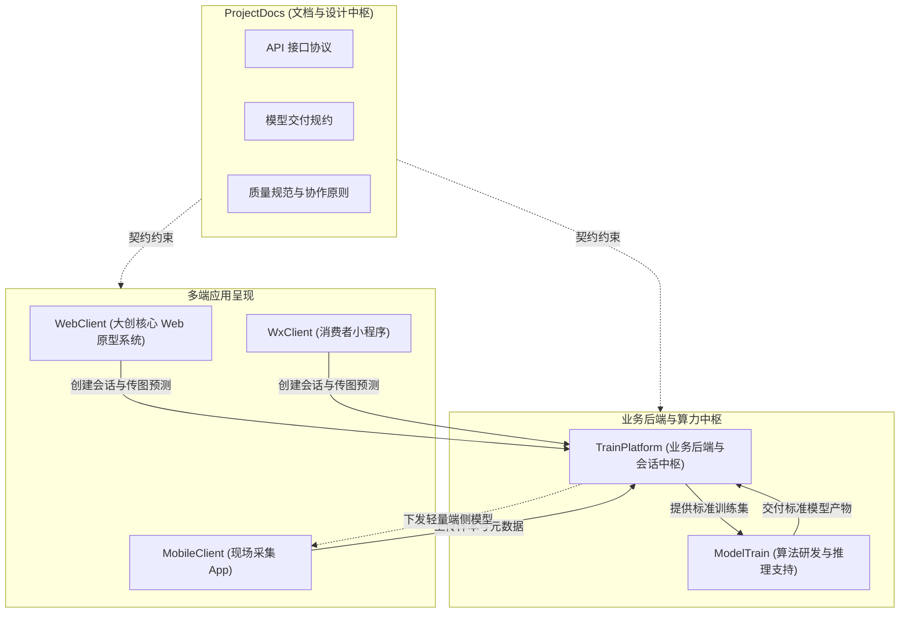

# 《轻眸识刻》多仓库全景地图与协作契约

> **组织归属**：`QingMouFoodDate` GitHub 组织  
> **文档定位**：全域 6 大仓库职责边界、跨仓协作契约与推进指南

---

## 一、 组织 6 大仓库矩阵全景

《轻眸识刻》项目采用按技术栈与运行环境解耦的多仓库架构：

| 仓库名称 (GitHub) | 中文定位 | 技术栈属性 | 职责边界与核心资产 |
| :--- | :--- | :--- | :--- |
| **`ProjectDocs`** *(即 ProjectPRD)* | **设计与文档中枢** | Markdown / Docs | **系统架构设计、跨仓统一接口契约、模型交付标准、四级能力矩阵与协作规范**。不存放业务代码。 |
| **[`TrainPlatform`](https://github.com/QingMouFoodDate/TrainPlatform)** | **业务后端与平台** | Python / Go / DB | **多端统一 API 服务、识别会话编排、集中样本存储、真实日期语义解析与状态决策引擎**。 |
| **[`ModelTrain`](https://github.com/QingMouFoodDate/ModelTrain)** | **算法研发与评测** | PyTorch / Python | **小目标打码检测、微型字符 OCR、多分支感知网络、8 项消融实验与轻量模型导出**。 |
| **[`WebClient`](https://github.com/QingMouFoodDate/WebClient)** | **Web 核心原型系统** | React / TypeScript 等 | **大创官方承诺成果 3：多图会话、原生相机/条码解析、双重视图、二维状态卡片、人工纠偏回流**。 |
| **[`MobileClient`](https://github.com/QingMouFoodDate/MobileClient)** | **移动端客户端** | Flutter / 原生等 | **面向移动实地场景的实拍工具、传感器防抖、本地离线台账、端侧轻量推理探索**。 |
| **[`WxClient`](https://github.com/QingMouFoodDate/WxClient)** | **微信小程序端** | 微信原生 / Taro 等 | **面向消费者的轻量免安装备选通道、长辈关怀大字模式、微信一键社交分享卡片**。 |

---

## 二、 多仓协同与契约依赖拓扑

### 核心归属判据：三问法定仓
1. **代码在哪里运行？**
   - 运行在手机 App 进程里 ➔ `MobileClient`
   - 运行在微信宿主环境中 ➔ `WxClient`
   - 运行在浏览器前台中 ➔ `WebClient`
   - 运行在后端常规常驻服务中 ➔ `TrainPlatform`
   - 运行在 GPU 训练与离线评测环境中 ➔ `ModelTrain`
2. **是接口契约还是内部实现？**
   - 跨仓接口定义、协议字段、输入输出格式 ➔ 归属 `ProjectPRD/contracts/`；
   - 接口的具体路由实现与业务逻辑 ➔ 归属各业务仓库。

---

## 三、 功能模块与仓库归属矩阵

| 功能业务模块 | ProjectDocs (中枢) | TrainPlatform (后端) | ModelTrain (算法) | 多端客户端 (Web / Wx / Mobile) |
| :--- | :--- | :--- | :--- | :--- |
| **01 数据采集与现场采图** | 采图规范与容差标准 | 接收上传接口、元数据存盘 | — | **MobileClient**：现场拍摄、防抖引导、断点续传队列 |
| **02 数据管理与清洗审核** | 质量红线与门禁规范 | 样本资产台账、多维检索、哈希查重 | 离线数据扩增与清洗算子 | **WebClient**：在线人工审核与标定辅助页面 |
| **03 标注中心与难例沉淀** | 标注几何与标签规范 | 在线标注工具、难例反馈接收 | 辅助预标注脚本 | **WebClient / Mobile**：错例纠错一键回流上报 |
| **04 训练调度与实验管理** | 8 项消融科研假设规约 | 训练任务远程调起、指标日志看板 | **全部核心**：小目标检测、OCR 网络、消融实验 | — |
| **05 模型轻量化导出** | 模型输入输出规格与字典规范 | 模型资产版本管理、下载分发 | **全部核心**：ONNX / TFLite 导出、量化评测 | **MobileClient**：端侧加载轻量模型做离线初验 |
| **06 多端在线推断与展示** | RESTful 会话 API 契约协议 | 会话编排、代理推理、状态推算 | 封装前向感知推理模块 | **WebClient**：双重视图与会话面板 **WxClient**：轻量卡片查验 |

---

## 四、 关键跨仓契约

### 1. 契约一：多端统一接口契约
- **规范文件**：`ProjectPRD/contracts/API接口协议.md`；
- **核心约定**：围绕 `RecognitionSession` 组织 RESTful 接口。各客户端仅依据规约中的语义与抽象动作进行数据收发，无需关心后端具体实现语言。

### 2. 契约二：模型交付契约
- **规范文件**：`ProjectPRD/contracts/模型交付规约.md`；
- **核心约定**：检测模型输入规范为 `[1, 3, 640, 640]`，输出固定格式候选阵列；OCR 模型严格附带标准 `dict.txt` 字符表；交付产物包含评测元数据卡片。

### 3. 契约三：数据质量底线
- **规范文件**：`ProjectPRD/standards/数据质量规范.md`；
- **核心约定**：任何进入系统的数据集，必须 100% 遵守 4 项生活环境容差与 6 大底线红线，单张原图无损审定，严禁任何形式的算法伪造与拼图大板粗审。
