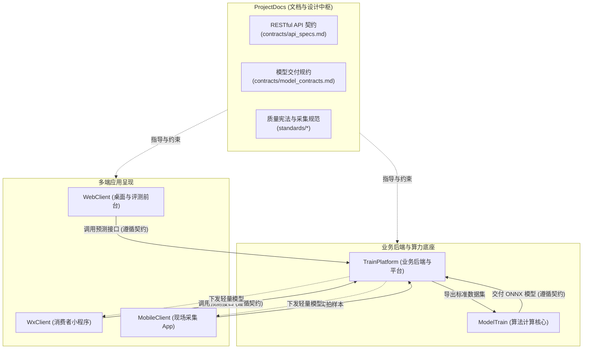
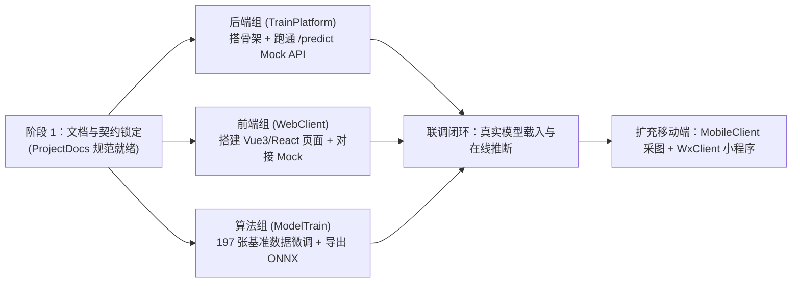

# 《轻眸识刻》多仓库全景地图与协作契约 (Multi-Repo Map & Contracts)

> **组织**：`QingMouFoodDate`  
> **文档定位**：全域 6 大仓库职责边界、跨仓协作契约与并行推进指南  

---

## 🗺️ 1. 组织 6 大仓库矩阵全景

整个《轻眸识刻》项目采用**按技术栈与运行环境解耦的多仓库架构**，杜绝大单仓臃肿与代码冲突：

| 仓库名称 (GitHub) | 中文定位 | 技术栈属性 | 职责边界与核心资产 |
| :--- | :--- | :--- | :--- |
| **`ProjectDocs`** *(即 ProjectPRD)* | **设计与文档中枢** | Markdown / Docs | **系统架构设计、产品需求规格 (PRD)、多端统一接口契约、模型交付标准、数据质量宪法**。严禁存放业务代码。 |
| **[`TrainPlatform`](https://github.com/QingMouFoodDate/TrainPlatform)** | **业务后端与训练平台** | Python / Go / DB | **多端统一 API 服务（预测/上传/纠偏）、样本资产与元数据管理、轻量训练任务调度、模型版本管理**。 |
| **[`ModelTrain`](https://github.com/QingMouFoodDate/ModelTrain)** | **算法计算核心** | PyTorch / Python | **小目标日期检测网络、包装日期微型 OCR、图像自适应增强算子、模型轻量化导出 (ONNX) 与 Benchmark 评测**。 |
| **[`WebClient`](https://github.com/QingMouFoodDate/WebClient)** | **Web 客户端 (在线识别与评测)** | Vue3 / React + Vite | **面向桌面端与全平台的食品包装日期在线拖拽识别、目标框/OCR/到期倒计时可视化、难例纠错标记、答辩演示大屏**。 |
| **[`MobileClient`](https://github.com/QingMouFoodDate/MobileClient)** | **移动端客户端 (实地采图 App)** | React Native / Flutter | **面向超市/仓库现场的高清实地采图工具、防抖防反光引导、包装类型与保质期初标、离线队列、端侧模型快速初验**。 |
| **[`WxClient`](https://github.com/QingMouFoodDate/WxClient)** | **微信小程序端 (C 端轻量查日期)** | 微信原生 / Taro | **面向普通消费者的极简“拍照查生产日期与是否过期”、倒计时提醒、即用即走**。 |

---

## 📐 2. 多仓协同与契约依赖拓扑

### 核心归属判据（三问法定仓）：
1. **代码在哪里跑？**
   - 跑在手机 App 进程里 ➔ `MobileClient`
   - 跑在微信宿主环境里 ➔ `WxClient`
   - 跑在浏览器前台里 ➔ `WebClient`
   - 跑在后端常规常驻服务里 ➔ `TrainPlatform`
   - 跑在 GPU 训练与离线评测环境中 ➔ `ModelTrain`
2. **是接口还是实现？**
   - 接口定义、协议字段、输入输出格式 ➔ 必须写在 `ProjectDocs/contracts/`；
   - 接口的路由实现与业务逻辑 ➔ 写在各仓代码中。

---

## 📑 3. 功能模块 ➔ 仓库归属矩阵

| 功能业务模块 | ProjectDocs (中枢) | TrainPlatform (后端) | ModelTrain (算法) | 多端客户端 (Web / Wx / Mobile) |
| :--- | :--- | :--- | :--- | :--- |
| **01 数据采集与现场采图** | SOP 与质量规范标准 | 接收上传接口、元数据存盘 | — | **MobileClient**：现场拍摄、防抖引导、断点续传队列 |
| **02 数据管理与清洗审核** | 事故复盘与 6 大红线 | 样本管理看板、审核流转、哈希查重 | 数据增强、切分清洗算子 | **WebClient**：在线人工审核与标定辅助页面 |
| **03 标注中心与难例沉淀** | 标注几何与标签规范 | 任务派单、错例反馈接收 | 辅助预标注推理脚本 | **WebClient / Mobile**：错例纠错一键回流上报 |
| **04 训练调度与实验管理** | 训练指标与 Benchmark 规约 | 本地/远程训练调起、指标日志看板 | **全部核心**：YOLO 小目标检测、OCR 识别网络、微调 | — |
| **05 模型轻量化导出** | 模型输入输出张量规格规约 | 模型资产版本管理、预签名下载下发 | **全部核心**：ONNX / NCNN / TFLite 导出、量化 | **Mobile / Wx**：端侧加载 ONNX 模型做离线初验 |
| **06 多端在线推断与展示** | RESTful API 契约协议 | `/api/v1/ocr/predict` 服务端调度与推算 | 核心推理引擎包装 (C++ / Python) | **WebClient**：桌面交互展示 **WxClient**：扫码查日期与过期推算 |

---

## 🤝 4. 关键跨仓契约（团队协作事实标准）

### ① 契约一：多端 ↔ `TrainPlatform` (HTTP RESTful 契约)
- **权威文件**：`ProjectPRD/contracts/api_specs.md`
- **核心约定**：统一 `/api/v1/` 命名空间。`WebClient`、`WxClient` 和 `MobileClient` 无需关心后端底层是 Python 还是 Go，仅依据规范中的 JSON 字段进行数据收发。

### ② 契约二：`ModelTrain` ➔ 后端与端侧 (模型交付契约)
- **权威文件**：`ProjectPRD/contracts/model_contracts.md`
- **核心约定**：模型输入固定为 `[1, 3, 640, 640]`，输出必须经过解算或包含固定格式的 Anchor/BBox 阵列；OCR 附带标准 `dict.txt`。

### ③ 契约三：全员数据质量底线 (质量宪法契约)
- **权威文件**：`ProjectPRD/standards/数据采集审核与质量控制规范.md`
- **核心约定**：任何进入系统的数据集，必须 100% 遵守实用平衡版规范（4 项放宽容差 + 6 大底线红线），单张原图无损肉眼审定，严禁任何形式的算法伪造与拼图大板粗审。

---

## 💡 5. 核心产品认知与保质期推导共识

1. **保质期推断：从包装上直接读，不建冗余商品库**：
   - 坚决不做沉重且维护成本极高的 SKU 平台商品库，保质期信息直接通过视觉算法从食品包装上提取（如“保质期 180 天”或“保质期至 2027-04-01”）；
   - 算法模型不仅需要检测并识别“生产日期”，也应识别“保质期”与“到期日”字段；
   - 客户端基于生产日期与保质期天数纯前端计算“剩余天数 / 是否临期”，轻量敏捷。
2. **WebClient 与 WxClient 的定位协同**：
   - `WebClient`：主打桌面端、大屏答辩演示、在线图片拖拽识别、目标框与置信度详细可视化、难例标定审核；
   - `WxClient`：主打 C 端普通消费者场景、一键拍照、极简即用即走。

---

## 🚀 6. 并行推进顺序与分工建议

各端无需相互等待，可按契约并行开工：

1. **关键路径**：优先让 `TrainPlatform` 依据 `api_specs.md` 提供一个能够返回 Mock 数据的预测接口；
2. `WebClient` 前端组立刻对接，完成精美的可视化拖拽页面与大屏答辩演示原型；
3. `ModelTrain` 算法组独立在实验室训练并导出 ONNX 模型，替换后端的 Mock 逻辑；
4. 三者一合龙，项目的核心可演示成果立刻达成！
