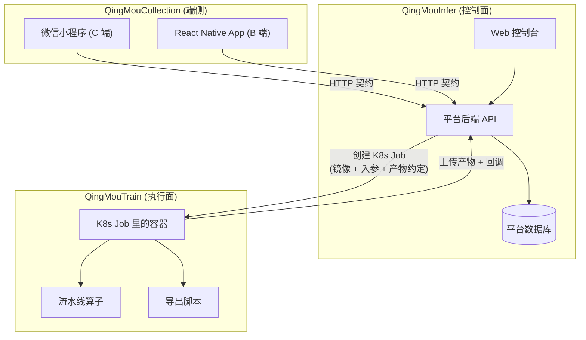
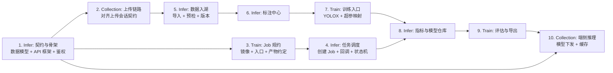

# 仓库地图 (Repository Map)

> 本文件定义 **产品文档 ↔ 代码仓库** 的映射关系，是拆分 Issue 的依据。
> 任何跨仓接口的变更，必须先改本文件与对应 PRD，再动代码。

---

## 1. 四仓结构

| 仓库 | 定位 | 一句话职责 |
| :--- | :--- | :--- |
| **[QingMouPRD](https://github.com/QingMouFoodDate/QingMouPRD)** | 产品文档 | 本仓库。BRD / MRD / PRD 索引 / 模块详述 / 仓库地图 |
| **[QingMouInfer](https://github.com/QingMouFoodDate/QingMouInfer)** | 基础训练平台（**控制面**） | Web 控制台 + 平台后端：数据、标注、调度、流水线、部署、系统 |
| **[QingMouTrain](https://github.com/QingMouFoodDate/QingMouTrain)** | 训练脚本（**执行面**） | 跑在容器里的代码：训练入口、流水线算子、评估、端侧导出、环境镜像 |
| **[QingMouCollection](https://github.com/QingMouFoodDate/QingMouCollection)** | 采集客户端（**端侧**） | 微信小程序 + React Native App：拍摄、上传、离线队列、端侧推理 |

### 分层原则

**归属判据**：一段逻辑属于哪个仓，看它**在哪运行**——
- 在**服务端进程**里跑 → `QingMouInfer`
- 在**训练/处理容器**里跑 → `QingMouTrain`
- 在**手机/小程序**里跑 → `QingMouCollection`

---

## 2. 模块 → 仓库 归属表

| 模块 | 文档 | QingMouInfer | QingMouTrain | QingMouCollection |
| :--- | :--- | :--- | :--- | :--- |
| **01 数据采集** | P0001–P0005 | 项目/SOP 定义、任务派发与领取、产物验收、采集统计 | — | **P0003 端侧实现**：拍摄、元数据、分片上传与断点续传、离线队列 |
| **02 数据导入** | P0020–P0024 | **全部**：上传会话、压缩包解压、格式解析、预检与清洗、类别映射 | 视频抽帧若以批处理脚本形式运行则在此 | — |
| **03 数据管理** | P0040–P0046 | **全部**：存储配置、数据集与版本、检索、预览、统计、导出、GC | — | — |
| **04 标注中心** | P0060–P0066 | **全部**：标注器（前端）、派单、质检、预标注编排、转写、统计 | 预标注的批量推理作业 | — |
| **05 训练平台** | P0080–P0087 | **控制面全部**：节点、镜像登记、任务提交与调度、日志看板、模型仓库、评估编排 | **执行面**：训练入口、超参→Exp 映射、checkpoint 存取与续训、产物上传回调、评估执行 | — |
| **06 流水线** | P0100–P0101 | 流程定义、编排、执行记录、重跑调度 | **算子实现**：去重、清洗、切分、增强、评估、导出、难例挖掘 | — |
| **07 部署推理** | P0110–P0113 | 服务发布与灰度（K8s Deployment）、在线试跑、调用统计 | 导出脚本（ONNX/TRT/OpenVINO/NCNN）、导出后精度复测 | — |
| **08 端接入** | P0120–P0122 | **服务端契约实现**：开放 API、鉴权、限流、模型下发清单 | — | **两端实现**：小程序与 RN 客户端的全部功能 |
| **09 系统管理** | P0130–P0132 | **全部**：用户与权限、审计日志、告警中心 | — | — |
| **训练环境镜像** | P0081 | 镜像登记与分发 | **Dockerfile 与镜像定义**（CUDA → PyTorch → YOLOX → 代码） | — |

---

## 3. 跨仓接口契约（Issue 拆分的关键切面）

这三个契约是**唯一的跨仓事实来源**。任一方变更，必须同步修改另一方的 PRD 与实现。

### 3.1 `QingMouInfer` ↔ `QingMouTrain`：**Job 规约**

| 项 | 约定 | 文档 |
| :--- | :--- | :--- |
| 触发方式 | Infer 创建 `K8s Job`，`TrainNode` 是 K8s Node 的镜像视图 | P0080 / P0082 |
| 镜像 | 以 **image digest** 固定（非 tag），`imagePullPolicy: IfNotPresent` | P0081 |
| 入参 | 超参快照（`params_hash`）、数据物化路径或预签名 URL、输出目录、`attempt` 序号 | P0082 / P0083 |
| 超参传递 | 由快照生成白名单化的 `exp_override.py` + 只读 `train_args.json` | P0083 |
| 数据入容器 | 对象存储预签名直读，或 PVC / hostPath 缓存 | P0082 |
| 产物约定 | 输出目录 `YOLOX_outputs/<experiment_name>/`；ckpt 命名固定（`latest_ckpt.pth` 等） | P0083 / P0087 |
| 产物出站 | 容器内上传对象存储 → 回调 Infer；幂等键 `(train_task_id, attempt)` | P0085 |
| 续训语义 | `attempt > 1` 默认从 `latest_ckpt.pth` 恢复（含 optimizer / epoch / lr） | P0087 |
| 失败分工 | 容器崩溃 → K8s `restartPolicy`；Pod 终态 Failed → 平台按 `attempt` 重试 | P0082 / P0087 |

### 3.2 `QingMouInfer` ↔ `QingMouCollection`：**端接入 HTTP 契约**

- 接口清单即 [P0120](./PRD/08_端接入/P0120_小程序接入契约.md)（21 个端点）与 [P0121](./PRD/08_端接入/P0121_RN客户端接入契约.md)（20 个端点）。
- **上传链路的权威定义在平台侧**：`UploadSession` / `UploadChunk` 由 P0020 定义，客户端只实现。
- **模型下发**：平台提供清单 + 预签名 URL；端侧下载并校验 sha256，按 `(model_version_id, target_platform)` 管理缓存。
- **端侧推理**：小程序走 `wx.createInferenceSession`（ONNX）；RN 走端侧推理运行时。端侧结果**只作体验优化**，服务端一律独立复核（零信任端）。
- 端上报的进度、置信度、本地粗标**不得**进入 `Annotation` 或数据集。

### 3.3 `QingMouTrain` ↔ `QingMouCollection`：**模型文件契约**

唯一的接触面是**导出产物**：`QingMouTrain` 产出 ONNX（及其它格式）→ 登记为 `ManagedFile(owner_type=MODEL_VERSION)` → `QingMouInfer` 下发 → `QingMouCollection` 加载。
端侧对外的接口是 **ONNX 文件 + 输入尺寸 + 前/后处理约定**（含解码与 NMS 是否在图内）。

---

## 4. 拆分 Issue 的建议顺序

按**依赖方向**拆，避免互等：

**关键路径**：先把 §3 的三个契约用最小实现打通（一条数据能上传 → 能训练 → 能导出 → 端上能跑），再按模块补深度。

---

## 5. 仓库初始化状态

| 仓库 | 状态 | 说明 |
| :--- | :--- | :--- |
| `QingMouPRD` | ✅ 已有内容 | 本文档所在的 PRD 仓 |
| `QingMouCollection` | ⬜ 空（仅 LICENSE） | 待初始化：小程序工程 + RN 工程 |
| `QingMouTrain` | ⬜ 空 | 待初始化：训练镜像 + 算子库 |
| `QingMouInfer` | ⬜ 空 | 待初始化：平台后端 + Web 控制台 |
