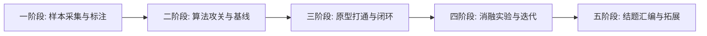

# 《轻眸识刻》项目推进路线图

> **文档定位**：项目实施、时间排期与交付物验收的内部推进参考，定义阶段里程碑、依赖关系与风险预案
> **上位依据**：大学生创新训练计划项目立项申报书与 [ADR-001](decisions/ADR-001-REPOSITORY_BOUNDARIES.md)
> **状态口径**：M0 与 C0 计划为 Planned，增强与实验为 Proposed；无验收链接，不声明已开发、已完成或已达标

## 零、M0 单图切片

M0 是待实现的 C0 单图最小切片，不等于完整 C0。迁移先统一文档和候选契约，再按文档 -> 代码 -> 测试 -> CI 推进，不自动重写历史。

| 顺序 | 最小交付范围 | 目标责任 | 验收前置 |
| :--- | :--- | :--- | :--- |
| 1 | 职责与契约对齐 | ProjectPRD | ADR 已批准；人工契约、OpenAPI 与四份 JSON Schema 已形成候选并需共同评审，明确 M0 子集 |
| 2 | 最小合规样本与冻结评测集 | TrainPlatform 职责下的审核流程 | 来源许可、单张原图审核、bbox/OCR/语义标注、group_key 防泄漏；不要求平台全部实现 |
| 3 | 可评测检测/OCR 基线与导出 | ModelTrain | 只读冻结数据，保留模型包与评测血缘，不要求 P2 或受限字表候选成立 |
| 4 | 单图在线链路 | InferPlatform | 业务 API、会话与资产、内部 runtime、Observation -> Evidence -> Decision，缺失/冲突明确提示 |
| 5 | 单图基础展示 | WebClient | 展示原图、检测框、OCR 原文、来源、标示期限与复核状态 |
| 6 | 真实验证记录 | 对应实现仓 | 需求 ID、代码与契约版本、命令、环境、结果、验收链接齐全后再变更状态 |

**M0 排除项**：多图追加与聚合、完整时间线/全景画布/微距交互、完整纠偏审核回流、MobileClient、WxClient、端侧推理、训练平台完整实现。基础展示不删减后续 C0 的完整展示目标。

**M0 准出条件**：在声明的环境上实际验证 Web 单图上传 -> runtime 检测/OCR -> Evidence -> 日期 Decision -> 基础展示；观察值与业务结论分离，双维状态和安全提示正确，非法输入与失败路径可验证。指标目标须有冻结口径与实测记录，不能用接口或模型卡片示例验收。

---

## 一、 五阶段实施推进路线

保留五阶段规划作为 M0 之后的最终目标与扩展参考，不代表当前进度，不以文档编排替代已确认日程。C0 是核心最终目标；C1 增强、C2 实验、C3 储备须分别评审，不能自动进入首轮交付。

### 1. 第一阶段 · 真实样本采集与质检准入
- **核心目标**：规划可追溯、获授权、覆盖多材质且防泄漏的真实包装基准集；
- **核心交付物**：
  - 严格通过质量门禁的真实实拍原图集；
  - 含来源许可、bbox、OCR 原文与语义标签的候选 `manifest.jsonl` 清单；
  - group_key 切分、negative/hardcase 隔离与审核冻结记录；
  - 完整性、查重与标注校验入口；哈希不是防伪或真实性证明。

### 2. 第二阶段 · 算法研发攻关与基线确立
- **核心目标**：建立可复现检测/OCR 基线，检验候选方法的适用边界；
- **核心交付物**：
  - 冻结数据上运行的检测与序列识别基线；
  - P2 检测头、受限字表等候选的对照方案，不预设必须采用；
  - 含配置、环境、失败项与结果链接的基线评测记录，由 TrainPlatform 登记；ModelTrain 只读执行。

### 3. 第三阶段 · Web 原型打通与端到端闭环
- **核心目标**：在 M0 后扩展完整 C0 Web 原型，不以多端实现作为核心前置；
- **核心交付物**：
  - 具备多图会话时间线、Canvas 检测框标注、微距视窗与二维状态卡片的 Web 原型系统；
  - InferPlatform 业务 API 接入与会话编排模块，不新增 Gateway 仓；
  - 日期规则、双维状态、安全提示与可追溯 Evidence/Decision；
  - 业务纠偏接受后立即重算，授权回流由 TrainPlatform 独立审核，保留待审、通过与拒绝台账。

### 4. 第四阶段 · 消融实验矩阵与算法迭代优化
- **核心目标**：按资源和能力分级评审 H1-H8，逐项开展中性对照，不要求储备实验全部完成才能验收 C0；
- **核心交付物**：
  - 已执行实验的真实结果与未执行问题清单，负结果同样保留；
  - 加权纠错等候选的独立增益、成本及误纠正分析；
  - 模型包、模型卡片与数据/评测血缘；TrainPlatform 治理 register/validate/release，InferPlatform 控制 activate/rollback，内部 runtime 执行。

### 5. 第五阶段 · 成果总结与多端拓展演进
- **核心目标**：汇总 C0 真实验收材料，评审后续移动与微信入口是否恢复实现；
- **核心交付物**：
  - 结题答辩完整报告与软件演示视频；
  - 软件著作权申请材料与学术论文初稿；
  - MobileClient 与 WxClient 的候选恢复计划；两仓当前暂停实现而非合并，不承诺已有原型；
  - C3 端侧研究的独立准入与评测计划，不作为结题核心交付替代项。

---

## 二、 阶段准入与交付准出条件

### 1. C0 级申报承诺准出条件
以下是待验收条件，不是当前成果：
1. 核心评测数据逐张审核且来源许可完整，标注通过门禁，group_key 切分无泄漏，冻结版本可追溯，近重复已人工复核；
2. 检测模型在冻结测试集上有分层指标及失败分析，目标阈值与口径先确定，当前未测量；
3. 识别模型分别报告字符准确率、字段全匹配率和 CER，通用与受限字表候选客观比较，不把采用某字表等同于达标；
4. Web 能在声明环境中展示单图与多图会话、完整画布/微距视窗/二维状态卡片及人工补录，并验证原始观察值、证据来源、日期规则和安全提示；
5. 完整纠偏闭环验证业务即时重算、独立训练资格审核与未审隔离；模型发布治理和线上切换各有可追溯记录，不要求训练平台所有管理界面实现；
6. 各项均关联原需求 ID、版本、命令、环境与验收链接，M0 通过不能直接认定完整 C0 通过。

### 2. C1/C2 级工程与科研准入条件
1. C1/C2 在核心链路具备真实验收记录后再单独评审，不以能力分级充当完成状态；
2. 实验须有冻结数据、基线对照、单变量或预登记组合、明确指标与资源预算；
3. C3 与 MobileClient/WxClient 恢复实现须另行批准，不挤占 C0；未执行实验不得补写推测数值。

### 3. 状态更新门禁

没有可追溯验收链接时需求保持 Planned/Proposed。设计决议只批准职责边界；路线图、演示截图、示例值和接口草稿都不能独立证明功能可用或效果达标。

---

## 三、 关键风险与应对预案

| 风险类别 | 风险表现形式 | 应对预案与规避措施 |
| :--- | :--- | :--- |
| **数据偏斜风险** | 某单一材质（如塑料袋）占比过大，导致易拉罐凹凸钢印泛化力不足 | 建立包装材质分布监控机制，针对瓶盖与金属罐底等低频难例实施针对性定向增补。 |
| **算力资源受限** | 在线时延或评测资源不足 | 优先单机基线和受控并发，先实测再决定调度方式，不预设新增队列或独立服务。 |
| **契约漂移** | 旧版职责、人工契约与后续机器契约不一致 | 先版本化评审并统一口径，再推进代码、测试、CI；示例不作为生产冻结依据。 |
| **数据泄漏与授权缺失** | 同组近重复跨 split，或在线纠偏未经许可进入训练 | group_key 隔离、来源许可审查、冻结审核与独立训练资格门禁。 |
| **范围混淆** | 将 M0 单图当完整 C0，或提前恢复暂停客户端 | 分别验收 M0 与完整 C0，保留后续需求，不新增仓或隐性扩大交付。 |
| **过度工程蔓延** | 团队陷入复杂的分布式微服务与权限管理中，影响核心算法进度 | 严格执行非目标（Non-Goals）界定，禁止在初期引入 Kubernetes、企业级单点登录等无关功能。 |
