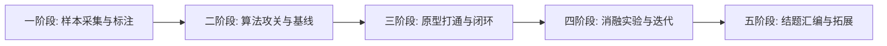

# 《轻眸识刻》项目推进路线图

> **文档定位**：项目实施、时间排期与交付物验收唯一事实来源，定义阶段里程碑、依赖关系与风险预案  
> **上位依据**：大学生创新训练计划项目立项申报书 · 进度安排

---

## 一、 五阶段实施推进路线

对齐申报书明确的执行周期，系统分为五个演进阶段：

### 1. 第一阶段 · 真实样本采集与质检准入
- **核心目标**：构建真实、客观、覆盖多包装材质的日期图像黄金基准样本库；
- **核心交付物**：
  - 严格通过质量门禁的真实实拍原图集；
  - 标准 `manifest.jsonl` 转录标注清单；
  - 自动化哈希查重与防伪质检门禁脚本。
- **当前状态**：`已达成`（第一批 197 张黄金样本全量通过验证）。

### 2. 第二阶段 · 算法研发攻关与基线确立
- **核心目标**：攻克极小目标检测网络与微型字符序列识别网络；
- **核心交付物**：
  - 浅层高分辨率特征融合小目标检测网络结构（P2 Head）；
  - 受限字符字典集微距序列识别模型；
  - 算法基线对比实验初版数据。
- **当前状态**：`进行中`。

### 3. 第三阶段 · Web 原型打通与端到端闭环
- **核心目标**：打通多端与后端的完整交互，实现立项申报承诺的核心展示原型；
- **核心交付物**：
  - 具备多图会话时间线、Canvas 检测框标注、微距视窗与二维状态卡片的 Web 原型系统；
  - 统一 RESTful API 网关与会话编排服务；
  - 核心日期推导与合规安全输出引擎。
- **当前状态**：`计划中`。

### 4. 第四阶段 · 消融实验矩阵与算法迭代优化
- **核心目标**：完成 H1~H8 全部中性消融实验，探索纠错矩阵与模型轻量化；
- **核心交付物**：
  - 8 项消融对比实验完整数据表格与分析报告；
  - 基于加权编辑距离的动态规划纠错矩阵；
  - 算法交付包与标准模型卡片。
- **当前状态**：`计划中`。

### 5. 第五阶段 · 成果总结与多端拓展演进
- **核心目标**：整理大创结题材料，探索移动原生与小程序轻量通道；
- **核心交付物**：
  - 结题答辩完整报告与软件演示视频；
  - 软件著作权申请材料与学术论文初稿；
  - MobileClient 与 WxClient 的基础原型验证版本。
- **当前状态**：`远期规划`。

---

## 二、 阶段准入与交付准出条件

### 1. C0 级申报承诺准出条件
必须在结题前 100% 达成以下硬性条件：
1. 样本数据集 100% 经过单张原图无损审阅，SHA-256 与 pHash 零冲突；
2. 检测模型在小目标测试集上检出率达到预设基线；
3. 识别模型在点阵受限字表下完全匹配率达到预设基线；
4. Web 原型系统能够在单机环境下完整演示“传图 ➔ 识别 ➔ 圈框 ➔ 算标示期 ➔ 纠偏”全流程。

### 2. C1/C2 级工程与科研准入条件
1. 必须在 C0 核心链路稳定运行并通过交叉验证后方可进入；
2. 实验方案必须具备基线对照与明确评估指标，严禁主观无对比推断。

---

## 三、 关键风险与应对预案

| 风险类别 | 风险表现形式 | 应对预案与规避措施 |
| :--- | :--- | :--- |
| **数据偏斜风险** | 某单一材质（如塑料袋）占比过大，导致易拉罐凹凸钢印泛化力不足 | 建立包装材质分布监控机制，针对瓶盖与金属罐底等低频难例实施针对性定向增补。 |
| **算力资源受限** | 实验室 GPU 节点无法支撑多端高并发长时间在线推理 | 采用推理运行时与业务解耦架构，客户端请求采用异步队列，优先保证单机离线评测。 |
| **过度工程蔓延** | 团队陷入复杂的分布式微服务与权限管理中，影响核心算法进度 | 严格执行非目标（Non-Goals）界定，禁止在初期引入 Kubernetes、企业级单点登录等无关功能。 |
