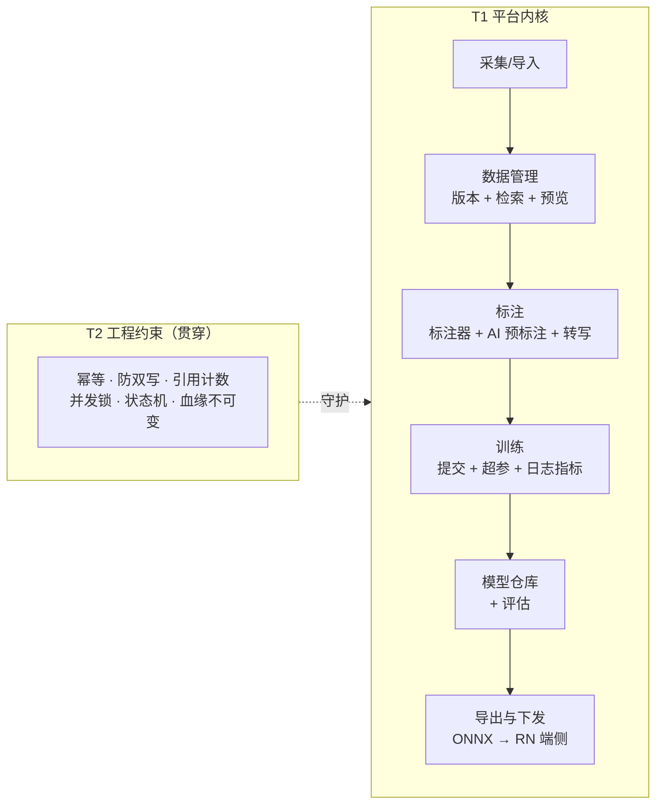

# 范围界定 (Scope)

> 本文件回答一个问题：**44 篇文档里，哪些是平台内核、哪些是不可省的工程约束、哪些是可以先不做的外端功能。**
> 它是拆分 Issue 与判断"做不完该砍谁"的唯一依据。

---

## 0. 定位校准

**本仓描述的是「训练基建平台」，不是业务模型本身。**

- 平台的成功标准 = **流程优雅好用**：从一批数据到一版模型，路径短、步骤少、不卡顿、不需要人写脚本。
- 模型在业务上的准确率（如日期读对率）属于**使用方**的目标。平台的责任是让它**可度量、可复现、可快速迭代**——平台提供度量能力，但不把别人的业务指标当作自己的北极星。
- 因此：**评价平台的好坏，看迭代一次要几步、要等多久、出错了要翻几个地方；不看 mAP。**

---

## 1. 三层分类

| 层级 | 含义 | 处置 |
| :--- | :--- | :--- |
| **T1 平台内核** | 没有它，平台就不成立 | **必做** |
| **T2 工程约束** | 不显眼，但一旦缺失就会出现"数据悄悄错了"的隐性事故 | **必做，且不可简化掉** |
| **T3 外端功能** | 面向外部用户、组织协作、规模化运维的功能 | **收敛 / 延后** |

**T1 与 T2 的边界**：T1 是"用户能看见的功能"，T2 是"保证 T1 不出错的内在纪律"。防双写、幂等、引用计数都是 T2 —— 它们不产生任何界面，但少了它们，数据会静默损坏，而且发现时已经不可追溯。

---

## 2. 逐篇归类

### 01_数据采集 (M01)

| 文档 | 档位 | 处置说明 |
| :--- | :--- | :--- |
| P0001_采集项目与SOP | **T3** | 收敛：保留"采集项目"概念，去掉 SOP 三层版本链（无多人协作时不成立） |
| P0002_采集任务派发 | **T3** | 延后：2~3 人不需要派单/领取/转交 |
| **P0003_移动端采集与上传** | **T1** | **必做**：RN 是真实采集端，拍摄、元数据、分片断点续传、离线队列都在这 |
| P0004_采集产物验收 | **T3** | 收敛：保留自动预检，去掉人工验收流程与理由码体系 |
| P0005_采集统计 | **T3** | 延后 |

### 02_数据导入 (M02)

| 文档 | 档位 | 处置说明 |
| :--- | :--- | :--- |
| P0020_本地上传与压缩包导入 | **T1** | 必做（数据入口） |
| P0021_标准数据集格式导入 | **T1** | 必做（会接手外部交付的数据集） |
| P0022_视频抽帧 | **T1** | 必做（现场多以视频采集） |
| **P0023_导入预检与清洗** | **T1** | **必做且优先级最高**：重复图、坏图、无目标、切分泄漏直接决定后面的指标真假 |
| P0024_类别映射与标签对齐 | **T1** | 必做（简化：保留映射与冲突检测，去掉大规模 profile 体系） |

### 03_数据管理 (M03)

| 文档 | 档位 | 处置说明 |
| :--- | :--- | :--- |
| P0040_存储配置与桶绑定 | **T1** | 必做（简化：本地目录 + 一个 S3 兼容后端即可，多存储并存延后） |
| **P0041_数据集与版本** | **T1** | **必做**：版本是"可复现"的根，也是模型血缘的挂载点 |
| P0042_数据检索与筛选 | **T1** | 必做（简化：够用的筛选维度即可） |
| P0043_数据预览与画廊 | **T1** | 必做（看数据的日常入口） |
| P0044_数据统计看板 | **T3** | 延后 |
| P0045_数据集导出 | **T1** | 必做（训练前要产出 COCO） |
| **P0046_数据回收与GC** | **T2** | **工程约束**：引用计数、防止误删被训练引用的数据、孤儿回收。功能可见，但本质是 T2 |

### 04_标注中心 (M04)

| 文档 | 档位 | 处置说明 |
| :--- | :--- | :--- |
| **P0060_标注器与标注几何** | **T1** | **必做，是全平台最核心的界面**：画框要顺手，快捷键要全，自动保存不能丢 |
| P0061_类别体系管理 | **T1** | 必做（简化：类别定义 + 颜色 + 快捷键、重命名零回填） |
| P0062_标注任务与派单 | **T3** | 延后（无多人协作时不成立） |
| P0063_质检与返工 | **T3** | 延后（保留自动检查：越界、零面积、疑似重复） |
| **P0064_AI预标注** | **T1** | **必做，效率关键**：用现有模型产候选框，人工只修正 |
| P0065_字符转写与OCR标注 | **T1** | 必做但**轻量**：框上多一个文本字段。若只做检测可不填，但字段与导出格式必须预留，否则将来补标注要返工 |
| P0066_标注统计与绩效 | **T3** | 延后 |

### 05_训练平台 (M05)

| 文档 | 档位 | 处置说明 |
| :--- | :--- | :--- |
| P0080_计算节点与资源池 | **T1** | 必做（单机 k3s 时极简：节点即本机；远端节点后续接入） |
| P0081_训练环境与镜像 | **T1** | 必做（镜像 + digest 锁定，是"可复现"的一半） |
| **P0082_训练任务提交与调度** | **T1** | **必做，平台主循环** |
| P0083_超参数与训练模板 | **T1** | 必做 |
| P0084_训练日志与指标看板 | **T1** | 必做（跑起来要能看着） |
| **P0085_模型仓库与Lineage** | **T1** | **必做**：模型反查数据/超参/镜像，是"可复现"的另一半 |
| P0086_模型评估 | **T1** | 必做（评估能力；具体指标口径由使用方定） |
| **P0087_断点续训与失败重试** | **T2** | **工程约束**：心跳、看门狗、attempt 幂等、OOM 降参。少了它，长训练白跑 |

### 06_流水线 (M06)

| 文档 | 档位 | 处置说明 |
| :--- | :--- | :--- |
| P0100_流水线阶段与算子 | **T3** | 收敛为**固定链路**（导入→清洗→切分→训练→评估→导出），去掉可编排 UI 与算子市集 |
| P0101_流水线执行与重跑 | **T3** | 收敛：保留"从失败点重跑"这一条，去掉模板体系 |

### 07_部署推理 (M07)

| 文档 | 档位 | 处置说明 |
| :--- | :--- | :--- |
| P0110_模型服务发布 | **T3** | 收敛：RN 要调模型测效果 → 只保留**一个最小推理接口**，去掉 Router、多版本服务、调用统计看板 |
| P0111_在线试跑 | **T1** | 必做（上传图看结果，是验收模型的日常动作） |
| **P0112_端侧导出** | **T1** | **必做**：RN 端侧测试模型需要 ONNX 产物与精度复测 |
| P0113_版本灰度与回滚 | **T3** | 延后 |

### 08_端接入 (M08)

| 文档 | 档位 | 处置说明 |
| :--- | :--- | :--- |
| P0120_小程序接入契约 | **T3** | 延后（C 端形态，等模型能用再说） |
| **P0121_RN客户端接入契约** | **T1** | **必做**：RN 既是采集端，也是模型验证端（端侧推理 + 采集上传） |
| P0122_开放API与鉴权 | **T3** | 收敛：RN 只需一个简单 token，去掉限流/配额/版本化承诺 |

### 09_系统管理 (M09)

| 文档 | 档位 | 处置说明 |
| :--- | :--- | :--- |
| P0130_用户与权限 | **T3** | 收敛为 **登录 + 单管理员**，去掉四角色权限矩阵 |
| P0131_审计日志 | **T3** | 延后（去掉哈希链与分区归档） |
| P0132_告警中心 | **T3** | 收敛为 **训练失败通知** 这一条，去掉规则引擎与去重抑制体系 |

---

## 3. T2 工程约束清单

这些约束**分散在上述文档中，必须逐条落实**。它们的共同特征是：**没有界面，但缺了会静默损坏数据。**

| # | 约束 | 所在文档 | 不做的后果 |
| :--- | :--- | :--- | :--- |
| 1 | **一个物理文件只登记一条 `ManagedFile`**，跨处用 `managed_file_id` 外键引用，`content_hash` 识别同一对象 | P0040/P0045/P0046 | 同一份数据存在两条记录 → 引用计数错乱 → GC 删掉还在用的文件 |
| 2 | **任务回调幂等**：`(train_task_id, attempt)` 唯一 | P0085/P0087 | 重试或网络重发 → 模型版本重复落库 |
| 3 | **上传幂等**：`(total_size_bytes, content_sha256)` 命中即复用 | P0020 | 弱网重传 → 存储翻倍、数据集出现重复样本 |
| 4 | **引用计数与删除保护**：被版本/任务引用的对象不可删 | P0041/P0046 | 删掉正在被训练引用的数据 → 训练断链且不可追溯 |
| 5 | **数据集版本不可变**：任何变更产出新版本 | P0041 | 血缘失效，历史模型无法复现 |
| 6 | **切分不变量**：同一 `group_key`（同视频/同批次/同包装）不得跨 `train`/`val` | P0023/P0041/P0100 | **mAP 虚高，上线即崩**——这是本项目最危险的坑 |
| 7 | **并发写同一张图互斥**：部分唯一索引 + 租约 + 乐观锁 | P0060/P0062 | 两人同标一张图，后写覆盖先写 |
| 8 | **坐标存储口径唯一**：原图归一化 float，不存相对/缩放后坐标 | P0060 | 换分辨率即错位 |
| 9 | **状态机白名单**：非法状态迁移直接拒绝 | P0082/P0041 等 | 任务卡死或重复执行 |
| 10 | **统一错误码**：`E<模块><P号后两位><流水>`，跨模块引用必须用真实码 | 全平台 | 排查时无法定位，跨模块语义漂移 |
| 11 | **血缘不可变**：`ModelVersion` 落库时一次性写死数据集版本/超参/镜像 digest/代码版本 | P0085 | "这个模型怎么来的"无法回答 |
| 12 | **训练产物归属单一**：训练产物 `TRAIN_TASK`；可部署物 `MODEL_VERSION`；一物一条 | P0085/P0112 | 双写导致同一文件两条记录 |

---

## 4. 收敛后的平台形态

**一期范围 = T1 全部 + T2 全部 + T3 中"收敛"项的最小实现。**

进度：T1 **25 篇** · T2 贯穿约束 **12 条** · T3 收敛或延后 **19 篇**。

---

## 5. "流程优雅好用"怎么度量

平台的成功标准不能只用功能清单衡量，必须可度量。一期以这四条为准：

| 指标 | 目标 | 说明 |
| :--- | :--- | :--- |
| **一轮迭代的步骤数** | 补一批数据并重训 ≤ 5 步 | 上传 → 标注 → 建版本 → 提交训练 → 看结果 |
| **一轮迭代的等待时间** | 无人工干预的等待占比 ≤ 30% | 剩下的时间只能等 GPU，不能等人 |
| **手工脚本数** | **0** | 平台外不应存在为跑通流程而写的脚本——有一个就说明平台缺功能 |
| **数据可追溯率** | 100% | 每个模型都能一键答出：用了哪版数据、哪组超参、哪个镜像 |
| **零静默错误** | T2 的 12 条约束全部有校验与拒绝路径 | 宁可报错，不可默默写错 |
