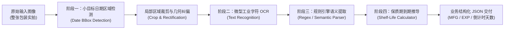

# 《轻眸识刻》核心算法推理与保质期推导流水线 (Inference Pipeline)

> **设计定位**：小目标检测驱动的端到端日期识别与语义后处理业务闭环  
> **核心痛点**：复杂工业包装背景下，整图通用 OCR 极易受到配料表文字干扰、易拉罐曲面反光与点阵断笔影响  

---

## 🔬 一、 两阶段端到端架构设计

通用 OCR（如微信扫一扫、通用 PaddleOCR）直接对整图进行大范围文本行检测，容易被包装上大段无关的营养成分表、品牌文案干扰，且对微小的点阵喷码召回率低。轻眸识刻采用**两阶段流水线（Two-Stage Pipeline）**解耦方案：



---

## 🛠️ 二、 各阶段详细设计与技术攻关

### 1. 阶段一：小目标日期候选框检测 (Date Region Detection)
- **输入**：RGB 图像（原尺寸，经 Letterbox 缩放至 $640 \times 640$）；
- **任务目标**：定位食品包装上的生产日期与到期日所在的小尺度打码区域（Bounding Box）；
- **目标类别**：
  - `date_area`（打码区域：包含点阵喷码、激光刻印、钢印凹凸文字等）；
- **模型选型**：轻量级小目标优化网络（如 YOLOX-Nano / YOLOv8n / RT-DETR-Tiny）；针对小目标特征浅层特征图设计高分辨率检测头（P2 Head），显著提升对微小字符区域的召回率。

### 2. 阶段二：局部自适应纠偏与增强 (Pre-processing & Enhancement)
针对检测出的局部打码框，进行精准切片与几何预处理：
- **微距透视变换**：若打码处于曲面或斜视角度，进行自适应仿射校正；
- **自适应对比度受限直方图均衡化 (CLAHE)**：消除金属易拉罐底与塑料包装反光高光盲区；
- **点阵字符连通性形态学闭运算**：对松散的点阵墨点进行轻度连通，防止笔画割裂。

### 3. 阶段三：局部微型字符 OCR 识别 (Specialized Date OCR)
- **输入**：校正后的打码区域局部切片；
- **模型选型**：专为工业字符微调的轻量化 CRNN (MobileNetV4 + BiLSTM + CTC) 或 SVTR-Tiny；
- **字典集约束**：严格限定字符集（数字 `0-9`、分隔符 `.-/:年\月日`、英文批号常用字母 `EXP`, `MFG`, `LOT`, `BEST BY`, `USE BY`），大幅降低模型预测熵与假阳性。

### 4. 阶段四：规则解析与保质期自动推算引擎 (Rule & Date Parser)
从 OCR 输出的非结构化字符串中提取真实生产日期、到期日与过期倒计时：

#### ① 日期模式匹配引擎（支持常见 12 种工业日期格式）：
- `YYYY/MM/DD`、`YYYY.MM.DD`、`YYYY-MM-DD`、`YYYYMMDD`
- `DD/MM/YYYY`、`DD.MM.YYYY`（进口食品反向格式）
- 汉字格式：`2024年05月01日`、`保质期至2025年11月`

#### ② 过期状态判定逻辑：
1. **情况 A：识别到直接到期日 (EXP)**：
   - 目标到期日 = $T_{\text{exp}}$
   - 倒计时天数 $\Delta = T_{\text{exp}} - T_{\text{today}}$
2. **情况 B：识别到生产日期 (MFG) + 包装录入保质期时长 (Shelf Life)**：
   - 目标到期日 $T_{\text{exp}} = T_{\text{mfg}} + \text{ShelfLife}$
   - 倒计时天数 $\Delta = T_{\text{exp}} - T_{\text{today}}$
3. **状态划分**：
   - $\Delta > 30$ 天：**安全 (Normal)** —— 绿色显示
   - $0 \le \Delta \le 30$ 天：**临期预警 (Near Expiry)** —— 黄色闪烁高亮
   - $\Delta < 0$ 天：**已过期 (Expired)** —— 红色醒目标识

---

## 📊 三、 最终结构化交付输出规范 (JSON Schema)

推理引擎最终对外部客户端（`WebClient` / `WxClient` / `MobileClient`）返回的标准响应数据格式：

```json
{
  "code": 200,
  "msg": "success",
  "data": {
    "detection": {
      "bbox": [124, 340, 280, 410],
      "confidence": 0.942
    },
    "recognition": {
      "raw_text": "MFG 2024.08.15\nEXP 2025.08.14",
      "confidence": 0.915
    },
    "parsed": {
      "date_type": "BOTH",
      "mfg_date": "2024-08-15",
      "exp_date": "2025-08-14"
    },
    "shelf_life_status": {
      "is_expired": false,
      "days_remaining": 316,
      "status_tag": "NORMAL",
      "status_text": "食品在保质期内，剩余 316 天"
    }
  }
}
```
