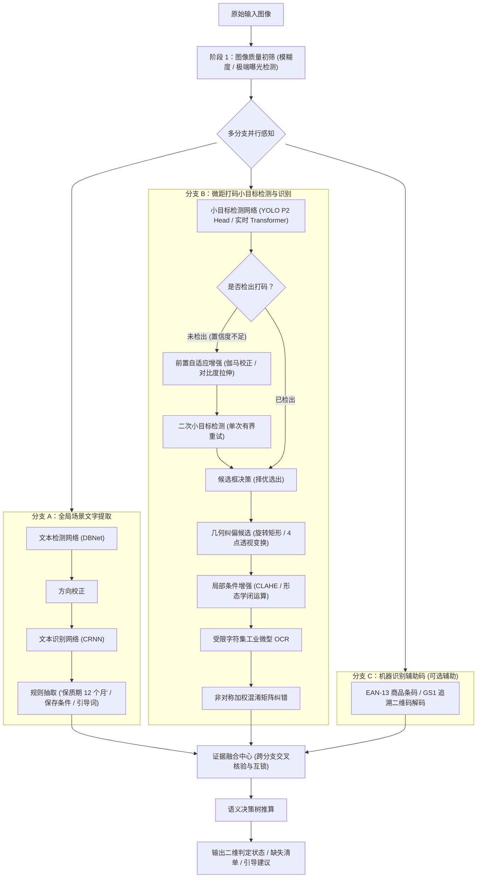

# 《轻眸识刻》多分支感知与日期标示推导流水线

> **设计定位**：多分支视觉感知、证据融合与真实日期语义推导业务闭环  
> **核心痛点**：复杂工业包装背景下，整图文字繁杂淹没打码、微距喷码占比极小且存在断针粘连

---

## 一、 多分支感知整体架构

系统摒弃单一依赖整图 OCR 或单一依赖局部检测的局限方案，采用**多分支协同感知与证据融合架构**：



---

## 二、 感知阶段关键技术攻关

### 1. 阶段一：图像质量快速初筛
- **清晰度评估**：基于拉普拉斯算子卷积计算高频分量方差，方差低于设定阈值判定为严重抖动模糊，给出稳定提示；
- **曝光检测**：统计全图灰度直方图，检测死白过曝区域面积占比，防止强光斑破坏识别特征。

### 2. 阶段二：多分支视觉感知并行推进
- **分支 A（全局场景文字提取）**：
  - 采用文本检测网络定位大面积印刷文本行，抽取包装背标上的保质期时长说明（如“保质期 12 个月”）、保存条件（“冷藏 0~4℃”）及位置指向词（“见瓶盖”）；
- **分支 B（微距打码小目标定位与微距识别）**：
  - 引入浅层高分辨率特征检测头（P2 Head），攻坚占全图面积不足 1% 的微小打码区域；
  - **单次有界重试**：首轮未检出时，仅执行一次前置自适应增强并重试，择优选出候选框，杜绝死循环；
  - **几何与增强条件候选**：区分主轴旋转角校正与四点单应性透视变换；将 CLAHE 和形态学闭运算作为可选条件增强分支，按检测置信度动态激活；
  - **受限字典微型 OCR**：字符集限定在数字、基础符号、少量限定汉字与缩写，抑制生僻字误报；
  - **非对称加权混淆矩阵纠错**：基于喷码断针物理先验（如 $O/D \leftrightarrow 0, I/l/T \leftrightarrow 1, S/3 \leftrightarrow 5, B/8 \leftrightarrow 8$）进行加权对齐。
- **分支 C（机器识别辅助码）**：
  - 解码商品 EAN-13 条码或追溯码，作为跨图先验辅助。

---

## 三、 真实日期语义与计期决策引擎

### 1. 实体分类与语义归一化
- **实体 A（生产日期 MFG）**：计期起点，如 `2026-04-10`；
- **实体 B（到期日 EXP）**：标示截止点，如 `2027-04-09`；
- **实体 C（保质期时长 Shelf Life）**：时长跨度，如 `12个月`、`180天`。

### 2. 日历进位与计期规范
- **自然月推进逻辑**：遵循公历进位规则（如 1 月 31 日生产，保质期 1 个月，截止日自动对齐至平年 2 月 28 日或闰年 2 月 29 日，严禁按固定 30 天粗暴折算）；
- **计期口径可配置化**：系统提供包含生产当日（$T_{end} = T_{start} + \text{Span} - 1\text{天}$）与满期对齐两种透明口径。

### 3. 多信元交叉校验逻辑
- **自洽性校验**：若同时提取到生产日期与到期日，反推时长 $\Delta = T_{end} - T_{start}$；若 $\Delta \le 0$ 或显著异常，标记证据冲突并提示复核；
- **条码品类校对**：条码反查品类常规货架期与提取保质期存在重大偏离时，输出异常提示。

---

## 四、 结构化输出规约

系统对外返回的标准化推算结果结构：

```json
{
  "assessment_status": "WITHIN_MARKED_PERIOD",
  "review_status": "NONE",
  "calculated_details": {
    "marked_prod_date": "2026-04-10",
    "marked_end_date": "2027-04-09",
    "days_to_end": 189
  },
  "evidence_chain": [
    {
      "source_type": "L1_PACKAGING_TEXT",
      "image_id": "img_001",
      "raw_value": "20260410",
      "normalized_value": "2026-04-10",
      "semantic_type": "PROD_DATE",
      "confidence": 0.942
    },
    {
      "source_type": "L1_PACKAGING_TEXT",
      "image_id": "img_002",
      "raw_value": "保质期12个月",
      "normalized_value": "12_MONTHS",
      "semantic_type": "SHELF_LIFE_SPAN",
      "confidence": 0.915
    }
  ],
  "missing_fields": [],
  "warnings": [
    "标示要求冷藏保存(0~4℃)，请确保储存环境符合包装标示",
    "实际可食用性受开封状态、包装密封性与冷链条件影响，本结果仅代表包装打码推算"
  ]
}
```
