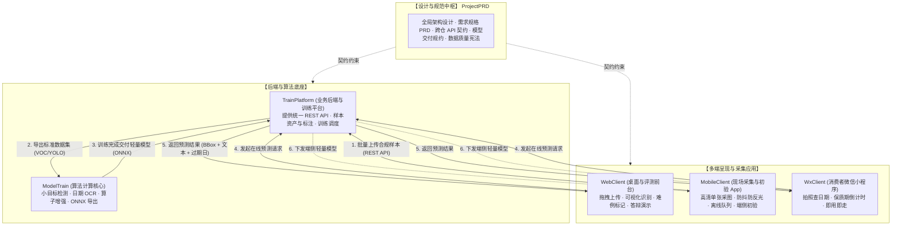

# 《轻眸识刻》系统总体架构设计方案

> **文档定位**：轻眸识刻全局顶层设计、数据模型流向与多端协同技术全景  
> **归属工程**：`QingMouFoodDate` 多仓库体系  
> **适用对象**：全体团队成员、算法/前端/后端/移动端研发人员、答辩评委  

---

## 一、 项目定位与业务愿景

**轻眸识刻** 是一套专注于**复杂工业包装与生活场景下小目标食品日期智能识别与保质期推导系统**。针对食品包装生产日期与保质期常存在的**字体偏小、点阵喷码粘连、金属/塑料曲面反光、包装褶皱、复杂背景干扰**等工业与生活痛点，系统构建了“小目标区域精准定位 ➔ 局部微型 OCR 识别 ➔ 规则引擎解析与过期倒计时推导 ➔ 多端可视化交付与难例回流”的完整工程闭环。

```text
图像输入 ➔ 图像预检与自适应增强 ➔ 日期区域小目标定位 ➔ 局部高精 OCR 文本识别 ➔ 规则解析与过期推算 ➔ 多端可视化交付 / 难例样本回流
```

---

## 二、 组织 6 大仓库多维协同拓扑

为适应多端业务线独立演进并保持敏捷落地，系统按**技术栈与运行环境**解耦为 6 个核心仓库：



---

## 三、 核心数据与业务生命周期

系统业务流包含四条核心主线，各仓库分工明确、不交叉耦合：

### 1. 数据采集与清洗主线
- **采图与录入**：由 `MobileClient` 在超市、食堂、家庭生活现场进行实物拍摄，录入包装类型与保质期说明（实体 C）；
- **汇聚与质检**：汇聚至 `TrainPlatform`，由审核人员严格遵循 `standards/` 规范执行单张原图无损审阅；
- **版本归档**：通过自动化质量门禁（物理文件对应、SHA-256 零重复、pHash 汉明距离防重）后冻结为训练数据集版本（如 `Dataset v2.1`）。

### 2. 算法研发与轻量化导出主线
- **算法训练**：`ModelTrain` 基于 PyTorch 进行小目标检测（先框选日期所在区域）与微型 OCR 识别网络的迭代训练；
- **算子增强**：针对点阵断笔、弧面扭曲、局部漫反射进行自适应增强；
- **模型导出**：将收敛的模型按 `contracts/模型交付规约.md` 规约导出为标准 ONNX / NCNN 格式，交付至 `TrainPlatform` 模型资产库。

### 3. 多端在线识别与业务推导主线
- **API 统一分发**：`TrainPlatform` 提供轻量统一的 RESTful 推理接口（`/api/v1/ocr/predict`）；
- **前台展示**：
  - `WebClient`：面向桌面用户与评审专家，提供拖拽测试、检测框高亮、置信度对比与保质期推导展示；
  - `WxClient`：面向大众消费者，手机扫码拍照即用，展示“距过期还剩 XX 天”的直观红黄绿卡片。

### 4. 错例纠偏与难例回流优化闭环
- 用户或评测人员在 `WebClient` 或 `MobileClient` 遇到漏检或识别错误时，可一键标记“错例纠错”；
- 错例原图与人工修正文本自动回流至 `TrainPlatform` 的待审难例池，为下一轮微调积累宝贵的真实边缘样本。

---

## 四、 架构落地与边界原则

1. **单机优先，严控复杂度**：
   - 坚决杜绝在项目早期强上 Kubernetes、复杂分布式 GPU 节点池等重型基建；
   - `TrainPlatform` 与 `ModelTrain` 保证在单台普通工作站或笔记本单卡上即可完整跑通；
2. **契约先行，接口解耦**：
   - 各仓库只需对 `contracts/` 规定的 HTTP 接口与模型张量规格负责；
   - 内部具体代码框架与选型可结合各端技术生态权衡选用，避免文档过度干预；
3. **数据真实性底线**：
   - 无论多端如何演进，全系统始终严守六大终身质量红线：**零伪造标签、零手绘红圈、零营销字幕、零电商假图、零非食品物品、零拼图大板粗审**。
