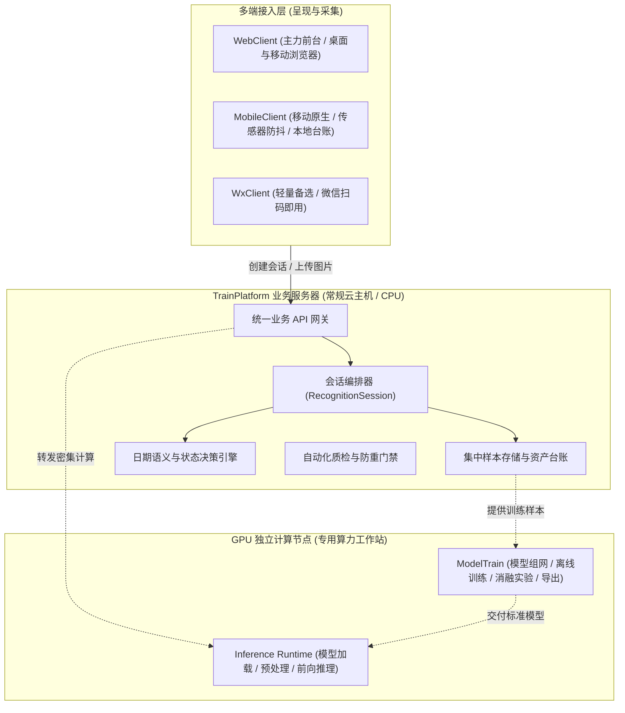

# 《轻眸识刻》系统总体架构设计方案

> **文档定位**：轻眸识刻系统顶层设计、组件职责边界与多端协同技术架构  
> **归属工程**：`QingMouFoodDate` 多仓库体系

---

## 一、 系统定位与业务主线

**轻眸识刻** 是一套专注于复杂食品包装微小日期区域检测、字符识别与标示期限推导的智能系统。针对字体偏小、点阵断笔、曲面反光与复杂图文干扰等现实痛点，系统确立了“找得到、读得准、判得清、能改进”的核心工程闭环：

```text
图像输入 ➔ 图像初筛 ➔ 双分支感知 ➔ 证据聚合与语义推导 ➔ 客观状态输出 ➔ 难例回流优化
```

---

## 二、 系统组件与职责边界划分

系统在逻辑与物理层面严格划分为业务中枢、推理运行时与离线算法研发三个组件：



### 1. TrainPlatform 业务与数据中枢
- 部署于常规云服务器（以通用 CPU、大容量存储与稳定网络 I/O 为主）；
- 核心职能：客户端识别会话（`RecognitionSession`）编排、全量样本存储与资产台账、真实日期语义与状态决策引擎、在线标注与质检防重、调度代理。

### 2. Inference Runtime 推理运行时组件
- 部署于独立 GPU 算力工作站或高算力计算节点，保持无状态设计；
- 核心职能：模型权重载入与常驻、输入图像质量初筛、多分支感知前向推理（全局文本检测识别与小目标打码检测识别），输出标准化的机器观察值。

### 3. ModelTrain 离线算法研发环境
- 部署于算法开发机与 GPU 训练环境；
- 核心职能：数据集预处理与扩增、检测与 OCR 网络组网、8 项科研消融实验、模型量化导出与模型评估卡片生成。

---

## 三、 证据体系与状态决策机制

### 1. 证据来源与采信等级
系统将机器观察值与真实客观事实解耦，构建五级采信规则：
- **L1 直接包装证据**：包装图像中肉眼直接可见的打码日期、保质期时长、保存条件文案，为最高优先级直接凭证；
- **L2 结构化机器码证据**：符合 GS1 规范、含有明文批次/日期应用标识符的条码或专用追溯码，经校验后参与计算；
- **L3 用户确认信息**：用户根据实物观察明确录入或人工修正的内容，记录操作溯源；
- **L4 上下文辅助信息**：包装上的指向性说明（如“见瓶盖”）、版面位置关系，仅作定位与消歧辅助；
- **L5 外部经验先验**：商品 EAN-13 69 码反查的品类常规货架期经验值，仅限异常提示，不得替代包装直接证据。

### 2. 二维状态输出模型
系统判定对象严格限定为“包装标示状态”，严禁向用户直接断言“食品绝对安全”：
- **期限判定状态 (`assessment_status`)**：`WITHIN_MARKED_PERIOD`（标示在期内）、`NEAR_MARKED_END`（标示临期）、`PAST_MARKED_END`（标示已超期）、`NOT_ASSESSABLE`（证据不足无法判定）；
- **复核状态 (`review_status`)**：`NONE`（正常自洽）、`INCOMPLETE_EVIDENCE`（信息缺失）、`EVIDENCE_CONFLICT`（证据冲突）、`LOW_CONFIDENCE`（低置信度）；
- **条件提示 (`warnings`)**：冷藏、冷冻、避光或开封后时效说明。

---

## 四、 渐进式三档部署演进

依据项目研发阶段与可用硬件资源，规划三档部署形态：

1. **一档：单机一体化研发模式（当前阶段）**：
   - 单台多核工作站同时承载 FastAPI 服务、本地样本文件系统与本地推理模块，满足原型验证与算法自测；
2. **二档：中心算力解耦模式（推进阶段）**：
   - 业务中枢部署于通用云服务器，推理运行时部署于独立 GPU 算力工作站，通过标准内网 HTTP / RPC 通信，支撑多端并发；
3. **三档：端云协同混合计算模式（远期探索）**：
   - 移动端内置轻量化量化模型执行高置信度离线推断，复杂样本或低置信度场景回传云端算力节点重检。
