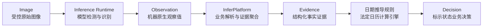

# 《轻眸识刻》核心数据结构与实体模型

> **状态**：全部 DTO、JSON Schema 与日期规则均为候选契约，不代表当前实现或验收完成。
> **适用范围**：离线样本资产、在线会话、Runtime 观察值与 InferPlatform 业务证据和决策。

## 一、事实主线与契约索引

数据实体处理链路如下：




- Runtime 仅生成原始 `Observation`，不生成业务 `Evidence`、`Decision` 或食品安全结论；
- 原始图像与机器观察值不可被人工修正或重算覆盖。重复推理生成新 `observation_id`，保留旧观察值及其模型版本；
- 人工修正保存独立 `Correction`，业务层新增 `MANUAL` 事实，形成新版 `Evidence` 和 `Decision`，历史记录可追溯；
- 派生到期日为决策中的日期投影，非 OCR 观察值，不伪造 MODEL 事实；
- 所有状态仅表达包装标示期限，不推断食品可食用性或存储履约情况。

| 候选契约 | 版本 | 机器结构定义 |
| :--- | :--- | :--- |
| Observation | `observation.v1` | [schemas/observation.v1.schema.json](schemas/observation.v1.schema.json) |
| Evidence | `evidence.v1` | [schemas/evidence.v1.schema.json](schemas/evidence.v1.schema.json) |
| Decision | `decision.v1` | [schemas/decision.v1.schema.json](schemas/decision.v1.schema.json) |
| Correction 请求 | `correction.v1` | [schemas/correction.v1.schema.json](schemas/correction.v1.schema.json) |
| 日期规则 | `date-rules.v1` | [日期推导规则.md](日期推导规则.md) |

### 1. 通用结构约束

四份 Schema 遵循 JSON Schema Draft 2020-12，对象显式约束 `additionalProperties: false`。`required` 字段必须出现，允许 `null` 不等于允许省略：

- ID 与版本标识为非空字符串；
- 日期为真实公历 `YYYY-MM-DD`（范围 `0001-01-01` 至 `9999-12-31`），须经日历有效性校验；
- 时间为带显式时区偏移的 ISO 8601 / RFC 3339 字符串（如 `2025-05-18T09:00:00+08:00`）；
- 数值必须为有限数，拒绝 NaN、Infinity；置信度为 `0..1` 或字段定义允许的 `null`。

## 二、离线 SampleAsset

`SampleAsset` 为离线受控资产管理记录，一行对应一个真实包装样本，**不等同于在线 `Image`**：

| 字段或分组 | 候选含义与审核要求 |
| :--- | :--- |
| `id`, `file_name`, `sha256`, `phash` | 真实资产标识、文件名、文件哈希与感知去重指纹 |
| `source` | 来源类别、采集时间、来源地址或记录引用 |
| `license` | 使用许可状态与依据引用 |
| `annotation` | 标注版本、状态、审核人与时间；保留 bbox、原始文字及 MFG / EXP 语义 |
| `text_raw`, `date_type`, `standard_date` | 肉眼可见文字、标示类型与审核后的标准日期 |
| `shelf_life_raw`, `shelf_life` | 包装原文及 `{value: 正整数, unit: DAY / MONTH / YEAR}` 或 null |
| `printing_tech`, `package_type`, `difficulty` | 印刷工艺、载体形态与难度分层 |
| `split`, `group_key` | 划分及同源分组键；同 group_key 不得跨训练、验证、测试集泄漏 |
| `review`, `is_benchmark` | 审核结论与依据；审核通过后允许 `is_benchmark: true` |

工艺枚举：`inkjet_dot_matrix`、`inkjet`、`laser_engraving`、`emboss`、`label_thermal`、`print`。载体枚举：`plastic_bag`、`can`、`bottle`、`bottle_cap`、`box`、`tetra_pak`、`plastic_tray`。

## 三、Observation 候选契约

由 Runtime 生成，保存本次前向计算得到的原始观察值：

| 必需字段 | 类型与约束 |
| :--- | :--- |
| `schema_version` | 固定 `observation.v1` |
| `observation_id` | 非空字符串，观察值唯一标识 |
| `image_id` | 非空字符串，引用原始 Image |
| `model_version` | 非空模型包版本标识 |
| `generated_at` | 带时区偏移时间，Runtime 生成时刻 |
| `image_size` | 包含 `width`, `height` 正整数，原图像素尺寸 |
| `quality_passed` | boolean 或 null（null 表示未提供判断） |
| `detections` | 检测项数组，可为空 |

每个 `detections[]` 必须包含：

| 必需字段 | 类型与约束 |
| :--- | :--- |
| `box_id` | 非空字符串，同一 Observation 内唯一 |
| `category` | 固定 `date_area` |
| `bbox` | 恰好四个非负有限数 `[x1, y1, x2, y2]`，单位为像素 |
| `bbox_format` | 固定 `xyxy` |
| `coordinate_space` | 固定 `original_image` |
| `confidence` | 检测置信度，有限数 `0..1` |
| `transcription` | 字符串或 null，原始 OCR 输出 |
| `text_confidence` | OCR 置信度，有限数 `0..1` 或 null |

坐标约束：`0 <= x1 < x2 <= width` 且 `0 <= y1 < y2 <= height`。坐标系必须映射回原图物理空间。

### 1. 明确可选的观察字段

| 可选字段 | 结构约束 |
| :--- | :--- |
| `quality_metrics` | 对象；包含 `blurriness_score` 与 `overexposure_ratio`（0..1） |
| `global_texts` | 数组；每项含 `transcription` 字符串与 `confidence`（0..1 或 null） |
| `barcode` | 对象；含 `type`, `value` 与 `confidence` |
| `detections[].character_confidences` | 0..1 有限数数组 |

## 四、Evidence 候选契约

由 InferPlatform 业务层从 Observation 及合法 Correction 提取、聚合事实：

| 必需字段 | 类型与约束 |
| :--- | :--- |
| `schema_version` | 固定 `evidence.v1` |
| `evidence_id`, `session_id` | 非空字符串，证据版本与会话引用 |
| `generated_at` | 带时区偏移生成时间 |
| `parser_version` | 非空解析策略版本 |
| `facts` | 事实数组，可为空；`fact_id` 唯一 |
| `conflicts` | 冲突数组，可为空 |
| `missing_fields` | 非空字符串去重数组，聚合发现的缺项 |
| `evidence_hash` | `sha256:` 加 64 位小写十六进制哈希 |

每个 `facts[]` 必须包含：

| 必需字段 | 类型与约束 |
| :--- | :--- |
| `fact_id` | 非空字符串，来源事实标识 |
| `field` | `mfg_date` / `exp_date` / `shelf_life` / `storage_condition` |
| `value` | 日期格式 `YYYY-MM-DD`；保质期 `{value, unit}`；存储条件为非空文本 |
| `raw_text` | 原始证据文本或 null |
| `source_type` | `MODEL` / `MANUAL` |
| `source_image_id` | 引用会话内真实 Image |
| `source_observation_id` | MODEL 时必填，引用真实 Observation；MANUAL 时为 null |
| `source_box_id` | 对应 Observation 检测框标识或 null |
| `source_correction_id` | MANUAL 时必填，引用合法 Correction；MODEL 时为 null |
| `confidence` | 有限数 0..1 或 null；MANUAL 固定 null |
| `eligible_for_decision` | boolean，由解析策略与修正规则共同决定 |

### 1. Evidence 哈希与不可变性

计算算法规范：
1. 取得完整 Evidence 对象，移除顶层 `evidence_hash` 字段；
2. 依据 [RFC 8785 JSON Canonicalization Scheme (JCS)](https://www.rfc-editor.org/rfc/rfc8785) 进行规范化，输出标准 UTF-8 字节；
3. 计算该字节流的 SHA-256，生成 `sha256:` + 64 位小写十六进制字符串。

任何事实、时间或策略变更均派生新版本，不覆盖历史。

## 五、Decision 候选契约

由 InferPlatform 依据引用的 Evidence、日期规则及服务端观察时刻生成：

| 必需字段 | 类型与约束 |
| :--- | :--- |
| `schema_version` | 固定 `decision.v1` |
| `decision_id`, `session_id` | 非空字符串 |
| `marked_status` | `WITHIN_MARKED_PERIOD` / `NEAR_EXPIRY` / `PAST_MARKED_PERIOD` / `UNDETERMINED` |
| `review_status` | `EVIDENCE_COMPLETE` / `INFORMATION_MISSING` / `EVIDENCE_CONFLICT` / `LOW_CONFIDENCE` |
| `observed_at` | 服务端业务观察时刻（带偏移 ISO 8601） |
| `generated_at` | 决策生成时刻 |
| `timezone` | 有效 IANA 时区名，默认 `Asia/Shanghai` |
| `calculation_rule_version` | 固定 `date-rules.v1` |
| `evidence_schema_version` | 固定 `evidence.v1` |
| `evidence_id`, `evidence_hash` | 引用不可变 Evidence 及其 JCS 哈希 |
| `evidence_snapshot` | 日期输入与派生投影快照 |
| `used_fact_ids` | 引用的真实事实 ID 去重数组 |
| `missing_fields` | 本次判定缺失的必要字段去重数组 |
| `warnings` | 告警信息数组，可为空 |
| `guidance` | 补拍或人工复核建议，不作食品安全结论 |

`evidence_snapshot` 子对象：

| 必需字段 | 类型与约束 |
| :--- | :--- |
| `mfg_date` | 真实日期字符串或 null |
| `shelf_life` | `{value: 正整数, unit: DAY / MONTH / YEAR}` 或 null |
| `exp_date` | 选定直接到期日或派生到期日，未选定为 null |
| `exp_date_is_derived` | boolean 或 null（直接 EXP 为 false，派生为 true） |

### 1. 二维状态语义

- **标示期限状态**：
  - `WITHIN_MARKED_PERIOD`：未超期且未触发临期；
  - `NEAR_EXPIRY`：剩余天数 <= 30，或剩余天数 * 10 <= 总寿命天数（到期当天属此状态）；
  - `PAST_MARKED_PERIOD`：剩余天数 < 0，即到期日次日起标示超期；
  - `UNDETERMINED`：证据无效、冲突或不足。
- **证据复核状态**：
  - `EVIDENCE_COMPLETE`：足以支持判定；
  - `INFORMATION_MISSING`：缺少必要输入；
  - `EVIDENCE_CONFLICT`：存在未解决冲突或时间逻辑错误；
  - `LOW_CONFIDENCE`：必要候选置信度不足。

优先级：CONFLICT > LOW_CONFIDENCE > MISSING > COMPLETE。

## 六、Correction 候选契约与最小实体

### 1. 字段级修正请求

| 必需字段 | 类型与约束 |
| :--- | :--- |
| `schema_version` | 固定 `correction.v1` |
| `image_id` | 归属会话的非空图像标识 |
| `corrected_field` | `mfg_date` / `exp_date` / `shelf_life` / `storage_condition` |
| `corrected_value` | 合法日期字符串、value/unit 对象或存储条件文本 |
| `correction_reason` | 非空修正理由 |

### 2. 在线 Image 最小字段表

| 必需字段 | 类型与语义 |
| :--- | :--- |
| `image_id`, `session_id` | 图像标识与归属会话 |
| `created_at` | 服务端带偏移创建时间 |
| `width`, `height` | 原图像素宽高 |
| `image_role` | `macro_date` / `packaging_full` / `barcode` 或 null |
| `asset_url` | 受控访问 URL 或 null |

### 3. RecognitionSession 最小字段表

| 必需字段 | 类型与语义 |
| :--- | :--- |
| `session_id`, `created_at` | 会话标识与创建时间 |
| `status` | 八状态之一 |
| `images` | Image 数组 |
| `observations` | 完整 Observation 数组 |
| `evidence`, `decision` | 当前完整 Evidence 与 Decision（或 null） |

### 4. Correction 存档最小字段表

| 必需字段 | 类型与语义 |
| :--- | :--- |
| `correction_id`, `session_id` | 修正标识与归属会话 |
| `created_at` | 存档时间 |
| `schema_version` 至 `correction_reason` | 原样保留验证通过的 correction.v1 请求内容 |

## 七、完整会话状态与 M0 候选子集

| 状态 | 候选语义 | M0 候选子集 |
| :--- | :--- | :--- |
| `AWAITING_INPUT` | 已创建，等待图片上传 | 是 |
| `RECEIVING_IMAGES` | 图片接收中间态 | 否 |
| `PROCESSING` | 推理与日期推导进行中 | 是 |
| `PARTIAL_RESULT` | 部分结果可用 | 否 |
| `COMPLETED` | 处理完成且无需复核 | 是 |
| `NEEDS_REVIEW` | 处理完成但需补充或复核证据 | 是 |
| `FAILED` | 技术处理失败 | 是 |
| `EXPIRED` | 会话已过期 | 否 |

## 八、内嵌结构样例与校验边界

### 1. Observation 最小完整结构样例

```json
{
  "schema_version": "observation.v1",
  "observation_id": "obs_example_001",
  "image_id": "img_example_001",
  "model_version": "det-rec-example.v1",
  "generated_at": "2024-05-18T09:00:00+08:00",
  "image_size": {"width": 640, "height": 480},
  "quality_passed": null,
  "detections": [
    {
      "box_id": "box_example_001",
      "category": "date_area",
      "bbox": [120, 240, 210, 310],
      "bbox_format": "xyxy",
      "coordinate_space": "original_image",
      "confidence": 0.935,
      "transcription": "MFG 20240518",
      "text_confidence": 0.912
    }
  ]
}
```

### 2. Correction 最小完整结构样例

```json
{
  "schema_version": "correction.v1",
  "image_id": "img_example_001",
  "corrected_field": "mfg_date",
  "corrected_value": "2024-05-18",
  "correction_reason": "人工核对包装生产日期文字"
}
```

```json
{
  "schema_version": "correction.v1",
  "image_id": "img_example_001",
  "corrected_field": "shelf_life",
  "corrected_value": {"value": 12, "unit": "MONTH"},
  "correction_reason": "人工核对包装标示12个月"
}
```

### 3. Evidence 结构片段

```json
{
  "schema_version": "evidence.v1",
  "evidence_id": "ev_example_001",
  "session_id": "sess_example_001",
  "generated_at": "2024-05-18T09:00:01+08:00",
  "parser_version": "parser-policy-example.v1",
  "facts": [
    {
      "fact_id": "fact_example_mfg",
      "field": "mfg_date",
      "value": "2024-05-18",
      "raw_text": "MFG 20240518",
      "source_type": "MODEL",
      "source_image_id": "img_example_001",
      "source_observation_id": "obs_example_001",
      "source_box_id": "box_example_001",
      "source_correction_id": null,
      "confidence": 0.912,
      "eligible_for_decision": true
    },
    {
      "fact_id": "fact_example_life",
      "field": "shelf_life",
      "value": {"value": 12, "unit": "MONTH"},
      "raw_text": null,
      "source_type": "MANUAL",
      "source_image_id": "img_example_001",
      "source_observation_id": null,
      "source_box_id": null,
      "source_correction_id": "corr_example_001",
      "confidence": null,
      "eligible_for_decision": true
    }
  ],
  "conflicts": [],
  "missing_fields": []
}
```

### 4. Decision 结构片段

```json
{
  "schema_version": "decision.v1",
  "decision_id": "dec_example_001",
  "session_id": "sess_example_001",
  "marked_status": "WITHIN_MARKED_PERIOD",
  "review_status": "EVIDENCE_COMPLETE",
  "observed_at": "2024-05-18T09:00:00+08:00",
  "generated_at": "2024-05-18T09:00:02+08:00",
  "timezone": "Asia/Shanghai",
  "calculation_rule_version": "date-rules.v1",
  "evidence_schema_version": "evidence.v1",
  "evidence_id": "ev_example_001",
  "evidence_snapshot": {
    "mfg_date": "2024-05-18",
    "shelf_life": {"value": 12, "unit": "MONTH"},
    "exp_date": "2025-05-18",
    "exp_date_is_derived": true
  },
  "used_fact_ids": ["fact_example_mfg", "fact_example_life"],
  "missing_fields": [],
  "warnings": [],
  "guidance": null
}
```

## 九、冻结前的真实校验清单

1. 四份 Schema 的 Draft 2020-12 校验，通过正负用例测试；
2. Runtime 验证原图映射、非有限数拦截与空检测处理；
3. InferPlatform 验证 MODEL / MANUAL 来源、会话归属、冲突处理与版本化可靠性策略；
4. 标准 JCS 实现验证属性排序、Unicode 处理与哈希完整性；
5. 日期引擎运行相关候选边界向量、时区转换与历史重放一致性测试；
6. API 与客户端联调验证会话生命周期与受控凭据流转。
