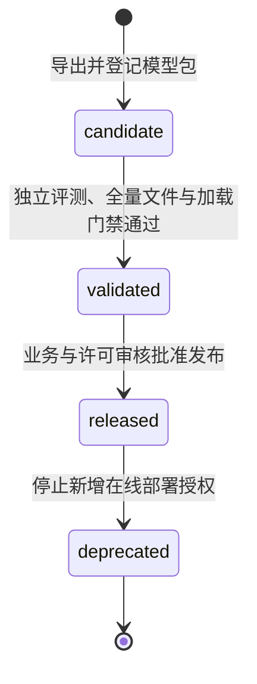

# 轻眸识刻模型交付与生命周期候选契约

> **状态**：`model-bundle.v1` 候选，不代表真实导出、评测、发布或激活已完成。
> **适用范围**：ModelTrain 导出，TrainPlatform 登记/验证/发布治理，InferPlatform 控制激活/回滚，内部 Runtime 校验与执行。

## 一、职责和产物边界

| 主体 | 设计职责 | 不负责 |
| :--- | :--- | :--- |
| ModelTrain | 训练、评测、消融、导出候选包与实验信息 | 客户端 API、日期 Decision、发布审批或线上激活 |
| TrainPlatform | 模型登记、血缘追溯、交付/评测校验、发布授权 | 在线前向推理或修改 active 指针 |
| InferPlatform | 选择授权版本、activate/rollback、记录实际版本 | 模型训练与替代发布审核 |
| Inference Runtime | 哈希/配置/张量校验、模型加载、检测/OCR、Observation | 会话、Evidence、日期 Decision 或发布授权 |

模型输出张量，Runtime 解码后构建 [DATA.md](DATA.md) 中的 Observation；模型与 Runtime 均不输出 marked_status、review_status 或食品安全结论。M0 可用单机工具与手工治理记录，不依赖完整管理平台或分布式调度。

## 二、候选包必需文件

交付包统一目录结构：

```text
release_bundle/                   # 不可变候选交付包
├── qingmou_det.onnx               # 日期区域检测模型
├── qingmou_rec.onnx               # 局部 OCR 模型
├── dict.txt                      # 字符与类别索引字典
├── preprocess.yaml               # 图像与张量预处理参数
├── postprocess.yaml              # NMS、阈值与解码参数
├── labels.json                   # 检测类别定义
├── metadata.yaml                 # 模型卡、输入输出 Profile 与兼容性
├── manifest.json                 # 文件清单、大小与 SHA-256
├── evaluation.json               # 评测配置、口径与基准指标
└── smoke/                        # 可复现的运行验证输入输出
    ├── input.json                # 输入资产/张量及其哈希
    └── expected.json             # 期望输出与容差范围
```

manifest.files 列出除 manifest.json 自身外的全部包文件、大小与 SHA-256（含配置、字典、标签、评测与 smoke），防止自哈希循环；manifest_sha256 校验 manifest 原始文件字节，bundle_sha256 校验固定打包格式的完整制品字节，两者由外部不可变登记绑定。同 model_version 不得换包、换配置或重新压缩，内容变更创建新版本。

解包与读取均拒绝绝对路径、父目录穿越、重复或规范化后冲突的条目、链接逃逸与包根目录外目标。smoke 输入可随包交付或使用受控引用，必须获授权、未过期且可取得；FP16 / INT8 等可选交付另记 Profile、校准数据版本与基准评测，不作为 M0 前置条件。

## 三、版本、模型卡与血缘

| 字段/记录 | 候选约束 |
| :--- | :--- |
| model_version | 不可变模型包标识，不使用 candidate、released 等状态值 |
| bundle_version | 包结构版本，当前候选 model-bundle.v1 |
| manifest_sha256 / bundle_sha256 | 外部不可变登记的真实完整性校验引用 |
| 文件清单 | 相对 path、size_bytes、sha256，与实际包逐项一致；路径校验按第二章执行 |
| 输入输出 Profile | 实际导出名字、dtype、shape/动态维度、坐标单位、轴含义与目标精度 |
| 预后处理 | 通道、缩放、letterbox/padding、mean/std、逆变换、阈值、NMS、字典、blank 与解码版本 |
| 兼容性 | runtime、min_runtime_version、opset 与目标平台/精度 Profile；发布范围只列实测通过组合 |
| 血缘 | dataset_version_id、train_config_hash、code_commit、runtime_version、eval_record_id、parent_bundle_id 及实际训练输入；父包关系不可循环 |
| 评测 | 冻结数据版本、split/分层、脚本/配置、硬件、精度、输入尺寸、冷/热启动、并发、计时边界与失败统计 |

模型内容、配置与血缘不可篡改。生命周期状态、审批与授权由外部治理记录追加，不修改包内文件哈希；生产消费者须核验具体包及用途的外部授权，不只信包内 model_status。

未测量指标填 null 并说明原因；validated / released 所需门禁须有真实独立评测。字符准确率、字段完全匹配率、CER、参数量、FLOPs、纯前向与端到端耗时分别定义，口径见 [算法实验.md](../算法实验.md)，示例或单图置信度不作为实测成绩。

## 四、输入输出 Profile 候选

下列张量与阈值为待真实导出和校准确认的设计路线，冻结前须以实际加载验证。

| 模型 | 候选输入 | 候选输出与待核验项 |
| :--- | :--- | :--- |
| 检测 | ONNX、FP32、RGB `[1,3,640,640]`，像素 / 255 | `[1,5,N]` 候选布局，类别轴、objectness、坐标与 N 由实际模型确认，不固定 N=8400；输出框映射回原图物理像素 |
| OCR | ONNX、FP32、RGB `[1,3,32,320]` | `[1,T,num_classes]` 候选布局，T、CTC blank/unknown、字典顺序与类别数须实际对齐 |
| 运行时 | ONNX Runtime，opset 17 路线 | 最低版本与算子支持由实际加载测试确认 |

检测配置须明确 resize/letterbox、padding、NMS 前后布局、阈值、坐标单位与原图逆变换；0.25 检测阈值、0.45 IoU 仅为历史候选起点。

OCR 候选等比例缩放至高度 32，右侧白底补齐宽 320；超宽切片由 Profile 明确缩放/分段策略，不截掉字符。标准化为 `(pixel / 255 - mean) / std`，候选 mean/std 均为 0.5，std 为标准差，实际取值须匹配训练与导出。字符级 EXP / MFG / LOT 按单字符索引，多字符 token 另记 Profile；验证字典覆盖、重复字符合并与字符置信对齐。

## 五、状态与动作

候选状态迁移链路如下：




| model_status | 候选语义 |
| :--- | :--- |
| candidate | 已登记导出候选，待门禁检查 |
| validated | 规定交付、独立评测、加载/smoke 与兼容门禁通过 |
| released | 获授权供生产 Runtime 加载（不等于 active） |
| deprecated | 停止新的部署授权；回滚须按明确授权政策核验 |

核心生命周期运维动作如下：

| 动作 | 主体 | 门禁与结果 |
| :--- | :--- | :--- |
| register | TrainPlatform 治理或 M0 手工登记 | 包、manifest、评测与血缘完整；同版同包复用登记，同版异包拒绝 |
| validate | 交付校验与评测程序，Train 登记 | 全文件完整性、真实加载、Profile、字典/坐标、授权输入 smoke、独立评测与兼容校验通过后置 validated |
| release | 授权审核人，Train 记录 | 审核指标、门禁、用途与许可，追加审批及授权记录后置 released |
| activate | Infer 控制，Runtime 执行 | 指定 released 版本，核验外部授权与兼容性，隔离加载并 smoke 验证后原子切换 active |
| rollback | Infer 控制，Runtime 执行 | 恢复仍获授权、兼容、完整且可取得的已验证旧版，重新核验并留痕 |

门禁失败保留原状态；register / validate / release 不由在线请求自动触发，Runtime 不自行追随 latest。candidate 可在隔离验证环境加载，生产使用须另获发布授权；治理记录保留申请者、审核者、版本、时间、原因与结果。

## 六、激活、失败与回滚

- 同一请求绑定检测、OCR、字典、标签与配置的完整 model_version，严禁混版；Observation 记录实际加载版本，业务层核验请求与返回引用；
- 候选实例隔离加载并执行 smoke 验证后原子切换引用；加载、验证或切换失败保持原 active 不变，正在执行的请求继续使用已绑定版本；
- 首次激活失败且无可用旧 active 时明确返回不可用，不生成伪成功 Observation；
- 保留仍有授权的 N-1 完整版本包与配置；回滚失败同样保持原 active 稳定；撤销授权、安全禁用或哈希损坏的版本禁止用于激活和回滚；
- 模型回滚不静默重算历史 Decision；历史 Observation、Evidence、日期规则与原观察时刻保持原状。

## 七、端侧分发与冻结检查

C3 端侧元数据接口由 [API.md](API.md) 定义，使用独立授权，返回 released 完整包的元数据、Profile、兼容信息及下载清单。客户端下载后校验固定包字节、manifest 与全部文件，动态 URL 不参与包哈希，失败时保留可用旧版。端侧仅生成候选观察值，端云协议未就绪前不替代统一业务决策。

冻结前核验项：真实导出、匹配字典与预后处理、授权输入 smoke、张量与原图坐标、独立评测数据/代码/配置/环境、制品与 manifest 哈希、发布审批、激活失败及回滚演练、Observation 实际版本记录。

