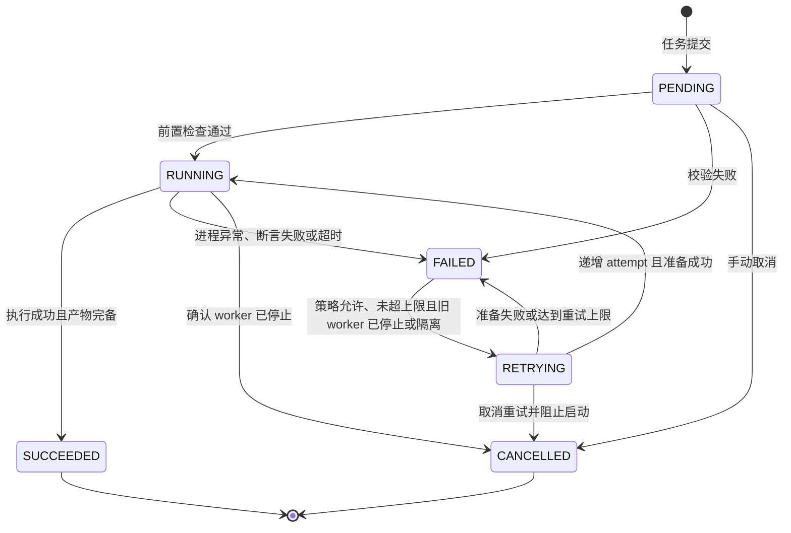

# 轻眸识刻离线数据与训练执行候选契约

> **状态**：`training.v1` 候选，契约不代表数据/标注平台、调度器或训练入口已实现。
> **边界**：TrainPlatform 治理、ModelTrain 执行；InferPlatform 仅移交受控待审记录。M0 允许单机执行与手工登记。
> **依据**：[DATA.md](DATA.md)、[MODEL.md](MODEL.md)、[数据质量规范.md](../standards/数据质量规范.md)、[系统架构.md](../系统架构.md)。

## 一、领域实体与唯一名称

| 实体 | 最小候选字段或引用 | 约束 |
| :--- | :--- | :--- |
| `SampleAsset` | [DATA.md](DATA.md) 中的来源、许可、审核、文件/标注、split/group_key | 不等同在线 Image；未审不入训练 |
| `ManagedFile` | file_id、sha256、size_bytes、asset_ref、created_at | 内容去重不消除逻辑样本各自的许可；受控引用不泄露路径 |
| `DatasetVersion` | dataset_version_id、parent_version、status、manifest_sha256、created_at、frozen_at、change_reason | 冻结后样本、文件、标注与切分均不可改 |
| `DatasetVersionItem` | dataset_version_id、sample_id、annotation_version、split、group_key | 明确标注修订版本，同源组不跨 split |
| `LabelTask` | label_task_id、sample_ids、annotation_types、assignee_ref、status、created_at | 标注范围、任务授权与返工可追溯 |
| `Annotation` | annotation_id、sample_id、annotation_version、annotator_ref、created_at、content_ref | 修订新增不覆盖；包含所需框、原文转录、日期语义与质量 |
| `LabelReview` | review_id、annotation_id、annotation_version、reviewer_ref、reviewed_at、result、reasons | result 为 APPROVED/REJECTED，未通过禁用 |
| `TrainJob` | train_job_id、mode、attempt、dataset_version_id、train_config_hash、code_commit、environment_ref、runtime_version、parent_bundle_id、output_ref、status、created_at | 调度事实由 Train 管理；完整执行输入见第三章，算法不反向改状态 |
| `EvalRecord` | eval_record_id、model_version、dataset_version_id、split、evaluation_config_hash、code_commit、environment_ref、metrics、created_at | 记录评测口径、分层与环境，不填示例为实测 |
| `ModelBundle` | model_version、bundle_version、manifest_sha256、bundle_sha256、dataset_version_id、train_config_hash、code_commit、runtime_version、eval_record_id、parent_bundle_id | 内容与血缘不可改；状态与发布独立追加，遵循 [MODEL.md](MODEL.md) |

样本采集、排除特征与标注规则严格依据 [数据质量规范.md](../standards/数据质量规范.md)，本契约不作重复定义。ParentDataset / ParentBundle 仅说明血缘关系，分别使用 parent_version / parent_bundle_id；AnnotationJob、TrainingJob、Evaluation、ModelArtifact 不作隐式实体别名。

## 二、纠偏移交、质量审核与冻结

1. InferPlatform 接受合法 Correction 后即时重算 Evidence/Decision，保存待审记录；不覆盖原 Observation；
2. 移交记录引用 correction_id、session_id、image_id、原观察值、新旧证据、受控 asset_ref 及训练用途许可依据，匿名会话凭证不作为训练许可；
3. TrainPlatform 独立核验来源许可、原图质量、标注与同源分组；
4. 审核通过（APPROVED）获得训练候选资格；通过审核不自动加入数据集或启动训练；
5. 将候选样本纳入新 DatasetVersion，补齐标注、审核、切分并冻结。

DatasetVersion 候选状态为 DRAFT、FROZEN、DEPRECATED。DRAFT 按审核流程修订；来源许可、审核、标注、文件/清单一致性与组泄漏检查通过后，固化全部成员、文件哈希、标注版本与 split/group_key，置 FROZEN。修改必须派生新版本，parent_version 引用已存在父版本且血缘不可循环；DEPRECATED 保留历史与引用保护。

split 统一使用 train、val、test；同商品、包装批次、采集会话、连拍与近重复簇按 `group_key` 切分，冻结前检查同源组泄漏及 train / val 非空。test 不用于调参、量化校准、阈值选择或自动策略搜索；发布评测使用独立冻结测试集。

## 三、任务级输入输出

执行入口由 ModelTrain 实现仓声明（CLI 或受控 worker）：

### 1. 执行请求

| 必需内容 | 候选结构与规则 |
| :--- | :--- |
| 身份 | schema_version=training.v1、train_job_id、attempt（正整数，首次为 1） |
| mode | TRAIN / EVALUATE / EXPORT，入口声明实际支持范围 |
| 数据 | dataset_version_id、manifest_sha256、受控 dataset_asset_ref（必须 FROZEN，校验实际清单与文件哈希） |
| 配置 | train_config_hash、config_ref（校验实际配置内容一致，不执行客户端注入的任意 shell） |
| 代码 | 完整 code_commit 及可重现工作区状态引用，未记录本地改动不得冒充该提交产物 |
| 环境 | environment_ref、runtime_version、设备与资源约束，固定可取得的环境与依赖清单 |
| 父模型 | parent_bundle_id（可为空；续训/微调须校验父包、checkpoint 哈希及配置/数据关系） |
| 输出 | 受控 output_ref 与每 attempt 隔离目录，不得与只读冻结输入重叠 |

ModelTrain 严格只读消费数据与标注，禁止重切分或写回冻结目录；清单、配置、代码、环境或父包校验不一致时拒绝执行。

### 2. 执行结果与事件

每个事件保留 event_id、train_job_id、attempt、worker_ref、event_time、state 及必要错误/产出引用；校验 worker 来源授权、事件顺序与回调身份，单机 CLI 同样保留事件记录。

结束结果包含退出状态、实际数据/代码/配置/环境引用、EvalRecord 或实验记录、候选包与 manifest/bundle 哈希；未产出字段为 null，当前 mode 必需产物缺失不得记成功。SUCCEEDED 表示执行与产物校验通过，不代表指标达标、validated / released 或允许发布。

失败、中断或取消保留错误类别、阶段、事件与关联引用；失败 attempt 和不完整包的输出隔离，不登记为有效 ModelBundle，日志不含秘密或不必要物理路径。

## 四、状态、重试与幂等

单机训练作业生命周期迁移链路如下：

| 当前 TrainJob 状态 | 允许的后继及条件 |
| :--- | :--- |
| PENDING | RUNNING；校验失败到 FAILED；取消到 CANCELLED |
| RUNNING | 执行及产物成功到 SUCCEEDED；失败或超时到 FAILED；取消须确认 worker 停止后到 CANCELLED |
| FAILED | 策略允许、未超上限且旧 worker 已终止或隔离后到 RETRYING；最终失败保留 |
| RETRYING | 递增 attempt 且准备成功到 RUNNING；准备失败或达到上限到 FAILED；取消并阻止新 worker 启动到 CANCELLED |
| SUCCEEDED / CANCELLED | 终态，不可逆转，回调不得恢复执行或回退状态 |

- 重试复用 train_job_id，递增 `attempt`，以 `(train_job_id, attempt)` 隔离输出并幂等登记；更换数据、代码、配置、环境或父包须新建任务，不伪装成原输入重试；
- 重复当前回调仅登记一次；迟到旧 attempt、无效顺序或终态后事件仅保留审计，不修改当前状态或 active，也不登记为当前有效产物；
- 看门狗超时可记录失败；重试前确认旧 worker 已停止，或隔离其计算与输出写入权限，无法确认则停止自动重试并转人工；RUNNING 的取消先请求停止，确认后才记 CANCELLED；
- 启动前检查算力、并发与存储，超出单机容量排队调度；重试上限、超时、取消与事件判定策略须版本化并验证。

## 五、评测、登记与发布

ModelTrain 产出真实实验与评测记录；TrainPlatform 登记并比对。结论关联数据版本、split/分层、脚本/配置、模型、设备、精度、输入尺寸、冷/热启动、并发、计时边界及失败统计；字符、字段、业务状态、前向与端到端指标分别定义，研究口径见 [算法实验.md](../算法实验.md)。

ModelTrain 仅交付 candidate 产物；TrainPlatform 治理 register/validate/release；InferPlatform 控制 activate/rollback，门禁遵循 [MODEL.md](MODEL.md)。register 以不可变 model_version 与制品哈希幂等登记：同版同包复用，同版异包拒绝；血缘一次登记，审批与状态追加。M0 可由单机工具与审核人保存门禁记录。

## 六、权限、保留与冻结检查

数据读取、标注、审核、调度与发布为独立授权动作；任务仅分配只读数据与隔离输出权限。资产清理前检查冻结版本与血缘引用，不得删除仍被引用的文件。

冻结前核验项：状态迁移合法性、重复/迟到回调、看门狗隔离与取消、同源组泄漏、来源许可、标注修订、冻结只读、数据/配置/代码/环境哈希不一致、父版本循环、失败输出隔离、模型同版异包拒绝、独立评测与发布授权留痕。
