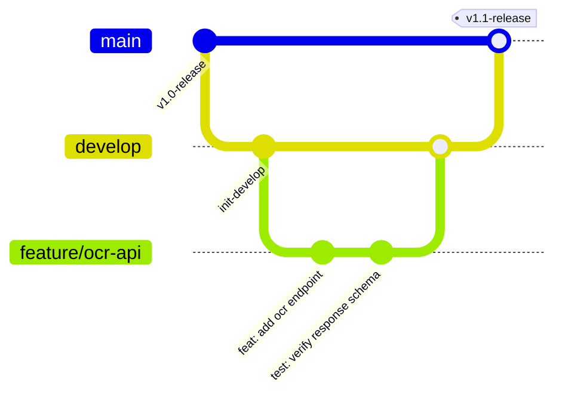

# 《轻眸识刻》多仓库代码协作与 Git 提交规范 (Git Workflow & Standards)

> **适用范围**：`QingMouFoodDate` 组织下全部 6 个代码仓库  
> **核心原则**：规范专业、分支有序、提交可溯、真实检查、杜绝大单次杂乱代码推送  

---

## 🌿 一、 分支管理规范 (Git Flow 敏捷版)

为保证主干分支永远处于“随时可演示、可部署”的稳定状态，各仓库统一推行以下分支策略：



1. **`main` 分支（稳定生产 / 答辩演示分支）**：
   - 受保护分支，严禁直接 `git push`；
   - 必须由 `develop` 分支经功能验证后通过 Pull Request (PR) 合并，保证任何时候拉取 `main` 都能直接稳定跑通；
2. **`develop` 分支（团队集成开发主线）**：
   - 团队日常功能集成主线；
3. **`feature/<name>` 分支（特性开发分支）**：
   - 组员接单开发具体功能时从 `develop` 切出（例如 `feature/web-canvas`、`feature/ocr-service`、`feature/onnx-export`）；
   - 自测通过后提交 PR 合并回 `develop`，合并后及时删除特性分支。

---

## 💬 二、 Commit 提交信息规范 (git-commit-plugin 风格)

全域各仓库严格推行统一的 **git-commit-plugin 风格** 规范，提交信息默认使用中文描述，严格遵循如下格式结构：

```text
<emoji> <type>: <简明中文改动>
```
或者带作用域的细粒度格式：
```text
<emoji> <type>(<作用域>): <简明中文改动>
```

### 完整 12 项提交类型与 Emoji 映射表

| Emoji & 类型 | 中文定位 | 适用场景与示例 |
| :--- | :--- | :--- |
| `🎉 init` | **项目初始化** | 仓库初始脚手架、初始工程框架、第一批基础配置搭建 |
| `✨ feat` | **添加新特性** | 实现新业务功能、新增 API 端点、新增交互组件等（例：`✨ feat(api): 增加 /ocr/predict 生产日期解析接口`） |
| `🐞 fix` | **修复 bug** | 修复缺陷、偶发崩溃、逻辑错误（例：`🐞 fix(ocr): 修复易拉罐金属曲面高光下字符截断问题`） |
| `🎈 perf` | **性能与体验优化** | 耗时缩短、内存占用优化、FPS 提升（例：`🎈 perf(engine): 优化 ONNX Runtime 预热推断耗时`） |
| `🦄 refactor` | **代码重构** | 不增加新特性也不修复 bug 的代码结构调整、算子解耦、模块拆分 |
| `📃 docs` | **仅仅修改文档** | 补充或更新 README、API 文档、系统架构图、注释说明 |
| `🌈 style` | **格式缩进调整** | 纯排版、代码缩进、分号、空格调整，不影响实际运行逻辑 |
| `🧪 test` | **测试用例** | 增加单元测试、集成测试用例、自动化质检测试 |
| `🔧 build` | **依赖相关** | `requirements.txt`、`package.json`、构建脚本或打包配置调整 |
| `🐎 ci` | **CI/CD 配置** | GitHub Actions 持续集成脚本、自动化部署流水线微调 |
| `🐳 chore` | **构建或辅助工具** | 辅助脚本、开发期抓取工具、环境辅助配置变更 |
| `↩ revert` | **版本回滚** | 回滚撤销此前某次错误的提交 |

---

## 🔍 三、 提交前真实核验铁律 (Verification Gate)

凡在本地工作区执行提交前，必须严格走完“真实核验三部曲”，严禁盲目提交或粉饰状态：

1. **Git 状态核实 (Real Status Inspection)**：
   - 提交前先运行 `git status` 与 `git diff`，确认当前改动范围干净，无无意产生的临时缓存（如 `.pyc`、`node_modules`、`.DS_Store`、日志）；
2. **真实检查与测试运行 (Real Test Execution)**：
   - 运行项目已有且与本次改动相关的静态检查、类型检查或单元测试脚本；
   - **红线约束**：仅对实际在终端中执行过且成功的检查声称通过；若无法运行或存在既有告警，如实汇报，严禁凭空捏造“测试通过”；
3. **严禁大型二进制文件污染 Git 历史**：
   - 任何图片数据集、权重文件（`*.pth`、`*.onnx`）、答辩 PPT 及 Office 文档严禁提交进代码仓库；
   - 数据请存放至独立暂存库 `../data/`，大创申报与汇报材料归档至 `../reports/`。
