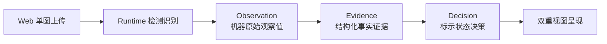
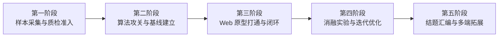

# 《轻眸识刻》项目推进路线图

> 项目实施推进参考，定义阶段里程碑、M0 优先交付切片、依赖关系与准入准出标准
>
> **上位依据**：[系统架构.md](系统架构.md)

《轻眸识刻》推进路线图以“小步快跑、端到端闭环、数据驱动、实验实证”为准则，确立当前攻坚重点与后续演进阶梯。

---

## 一、M0 单图最小验证切片

系统优先实施 **M0 单图端到端切片**，聚焦单图主链路的核心可用性：

| 执行序列   | 核心交付成果               | 责任主体仓    | 准出验证标准                                              |
| :--------- | :------------------------- | :------------ | :-------------------------------------------------------- |
| **Step 1** | 全域架构与候选契约闭合     | ProjectPRD    | 架构边界已裁定，OpenAPI 3.1 与 4 份 Schema 机器校验通过   |
| **Step 2** | 最小合规真实样本集冻结     | TrainPlatform | 真实样本入库核验，建立防泄漏 group_key 分组与不可变版本   |
| **Step 3** | 算法基线网络与模型包导出   | ModelTrain    | 单机 CLI 完成初版检测与识别训练，导出符合规约的标准模型包 |
| **Step 4** | 在线服务编排与推导流水线   | InferPlatform | 跑通会话创建、单图上传、Runtime 推理与法定日期推导主流程  |
| **Step 5** | Web 交互原型与双重视图呈现 | WebClient     | 实现单图上传交互，准确渲染原图检测框覆层与双维度状态卡片  |
| **Step 6** | 端到端冒烟集成与测试留痕   | 全体工程仓    | 自动化与人工冒烟测试通过，留存完整的可复核测试记录        |

### M0 准出红线与排除项

- **准出红线**：在声明环境中实测跑通以下完整处理链路：

- **M0 排除项**：多图时间线追加与聚合、复杂曲面展开、移动端传感器与小程序开发、人工纠偏审核流属于后续阶段目标，不作为 M0 阻断条件。

---

## 二、申报书五阶段实施推进路线

### 1. 第一阶段 · 真实样本采集与质检准入

- 组建覆盖纸盒、塑料薄膜、金属罐、玻璃瓶的多材质真实样本库；
- 实施样本准入与防泄漏切分（`group_key`），构建基线冻结数据集；
- 确立点阵、激光与钢印等特殊喷码的标注规约。

### 2. 第二阶段 · 算法研发攻关与基线建立

- 确立检测基线（YOLO 系列）与 OCR 识别基线（CRNN/SVTR）；
- 开展 P2 高分辨率小目标检测层（H1）与受限字典先验（H3）单变量对照实验；
- 打通单机 CLI 训练、评测与标准 ONNX 模型包导出管线。

### 3. 第三阶段 · Web 原型打通与端到端闭环

- 实现 InferPlatform 统一会话生命周期与内置 Inference Runtime 集成；
- 实现 WebClient 核心页面原型，拉通单图端到端识别与双重视图呈现（完成 M0 验收）；
- 引入法定公历日历推导引擎（`contracts/日期推导规则.md`），规范标示状态输出。

### 4. 第四阶段 · 消融实验矩阵与算法迭代优化

- 推进 H1 至 H8 消融实验矩阵，分层记录材质与喷码维度的精度指标；
- 推进多图会话流转与跨图一致性证据聚合（推进 C0 完整目标）；
- 打通字段级人工纠偏（`correction.v1`）与 TrainPlatform 审核回流闭环。

### 5. 第五阶段 · 成果总结与多端拓展演进

- 汇总实验数据，撰写技术报告与大创项目结题材料；
- 推进移动端（MobileClient）与微信小程序端（WxClient）的设计转化与工程落地；
- 开展边缘轻量化量化（INT8）与端侧前向推理可行性评测。

---

## 三、阶段准入与交付准出条件

各阶段演进遵循质量门禁：

| 门禁类型         | 核心检验标准                                              | 违规处置与防线                                 |
| :--------------- | :-------------------------------------------------------- | :--------------------------------------------- |
| **真实数据门禁** | 准入数据必须具备清晰来源许可与物理文件哈希指纹            | 严禁伪造、合成或算法脑补样本，违规数据一票否决 |
| **契约语法门禁** | 跨仓数据流转须 100% 满足 OpenAPI 3.1 与各 Schema 校验标准 | 任何字段名不一致或结构错误均阻断阶段准出       |
| **法律伦理门禁** | 全链路输出严格限定为“包装标示状态”                        | 严禁向用户直接断言食品绝对可食用等卫生健康结论 |

---

## 四、权威依据与参考文档

| 规范维度           | 事实源契约                                                                                                                       | 核心约束说明                                  |
| :----------------- | :------------------------------------------------------------------------------------------------------------------------------- | :-------------------------------------------- |
| **系统设计与规划** | [需求规格.md](需求规格.md) · [系统架构.md](系统架构.md) · [算法实验.md](算法实验.md)                                             | 确立系统功能边界、8 仓架构分层与消融实验基准  |
| **跨仓技术契约**   | [contracts/API.md](contracts/API.md) · [contracts/DATA.md](contracts/DATA.md) · [contracts/openapi.json](contracts/openapi.json) | 统一会话编排、REST 接口端点定义与核心数据模型 |
