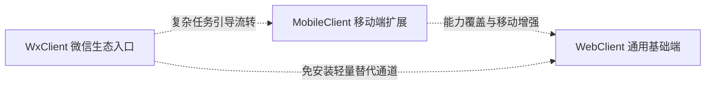
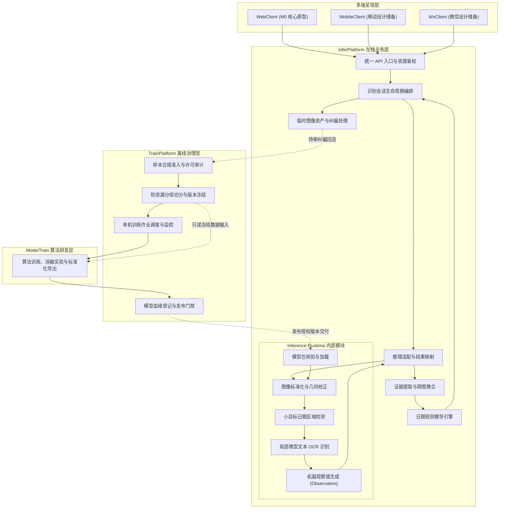
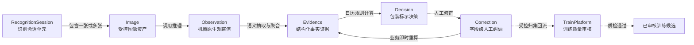

# 轻眸识刻系统总体架构

> 系统物理拓扑、在线与离线解耦边界、数据流模型与部署拓扑规范
>
> **设计状态**：八仓职责已采纳 · M0 待实现 · 契约与部署方案待评审

《轻眸识刻》面向食品流通与消费场景，负责识别包装生产日期与保质期文本，并基于日历规则推导包装标示状态。系统通过明确的物理边界与契约约束，实现数据治理、算法研发、在线服务与多端呈现的全链路解耦与工程协同。

---

## 一、系统定位与架构决议

系统采用以下六项核心架构原则与决议：

| 原则编号 | 核心架构原则     | 责任主体与工程边界                 | 红线约束与设计目标                                                                               |
| :------: | :--------------- | :--------------------------------- | :----------------------------------------------------------------------------------------------- |
|  **P1**  | **判定对象范围** | 各客户端及服务端               | 输出严格限定为“包装标示状态”，严禁直接向用户断言食品绝对可食用等卫生健康结论                     |
|  **P2**  | **在线离线解耦** | `InferPlatform` vs `TrainPlatform` | 在线业务响应与离线数据实验治理物理分离，各司其职，互不侵入                                       |
|  **P3**  | **推理分层隔离** | `Inference Runtime`（内部模块）    | 作为 InferPlatform 内部逻辑模块协同运行，仅计算输出客观感知值（Observation），不掺杂业务会话逻辑 |
|  **P4**  | **数据只读消费** | `ModelTrain`（算法中心）           | 严格只读消费由 TrainPlatform 冻结的快照数据，严禁算法层私自清洗样本或篡改数据划分                |
|  **P5**  | **闭环质量门禁** | `TrainPlatform`（治理审核）        | 用户线上纠偏即时重算业务决策；回流离线训练须独立审核来源许可、标注质量与分组，防止标签污染                 |
|  **P6**  | **标准化演化线** | 全链路数据实体流转                 | 严格遵循 `Observation -> Evidence -> Decision` 单向演化管线，历史观察值绝对不可篡改              |

### 架构决策背景与边界裁定

1. **保留 8 仓**：全系统划分为 8 个独立代码仓库，不新增 Data、Registry、Gateway 或 Runtime 独立仓；Inference Runtime 是 InferPlatform 内部模块，不形成第 9 仓；
2. **治理与执行严格分离**：模型 `register / validate / release` 归 TrainPlatform 离线治理；在线 `activate / rollback` 归 InferPlatform 控制；发布授权不等于线上自动生效；授权与 `active` 切换分别记录版本、模型包哈希、操作时间和结果；
3. **业务纠偏与训练资格分离**：InferPlatform 接受业务纠偏后立即重算当前决策；TrainPlatform 对回流数据独立审核来源许可、标注质量与防泄漏分组，未过审数据绝对不进入训练集；
4. **阶段范围约束**：M0 为 C0 单图最小验证切片，多图聚合、完整纠偏审核流与移动专属功能后续实施；MobileClient 与 WxClient 暂缓实现，恢复时单独评审。

---

## 二、八仓物理拓扑与职责矩阵

系统由 8 个职责单一、物理隔离的 Git 代码仓库构成：

| 仓库名称          | 物理定位     | 核心架构职责                                                     |
| :---------------- | :----------- | :--------------------------------------------------------------- |
| **.github**       | 组织全局配置 | 维护组织公开主页、跨仓工程导航与统一开源规范（Public 仓库）      |
| **ProjectPRD**    | 系统规范中枢 | 维护需求池、架构设计、跨仓契约、质量规范与演化基准（SSOT）       |
| **InferPlatform** | 在线服务中枢 | 承接多端 API、会话生命周期编排、内部推理适配、证据聚合与即时决策 |
| **TrainPlatform** | 训练治理中枢 | 负责受控样本准入、数据集版本冻结、标注审核留痕与模型发布门禁     |
| **ModelTrain**    | 算法研发中心 | 负责日期定位网络与微型 OCR 算法攻关、消融评测与标准模型包导出    |
| **WebClient**     | Web 原型系统 | 大创核心交付物，拉通 M0 单图主链路验证，呈现原图覆层与字段卡片   |
| **MobileClient**  | 移动端客户端 | 规划现场拍摄手持稳态检测、微距对焦引导与离线食品台账设计储备     |
| **WxClient**      | 微信小程序端 | 规划长辈大字关怀模式、免安装即开即用通道与社交卡片设计储备       |

---

## 三、多端客户端协同架构

- **WebClient**：作为不依赖特定移动操作系统的桌面与通用大屏基准端，优先验证 M0 单图全闭环；
- **MobileClient**：规划在 Web 在线查验能力基础上，利用移动设备传感器提供手持防抖与离线队列支持；
- **WxClient**：针对低使用门槛场景，规划长辈大字阅读与免安装查验通道。

---

## 四、系统分层架构与数据交互流

---

## 五、核心领域实体与演进管线

系统严格遵循不可篡改与分层派生的数据实体流转范式：

- **Observation**：保存机器原生检测框、置信度与识别文本，归档后绝对只读；
- **Evidence**：保存经业务层提取的结构化生产日期、到期日与保质期事实，附带置信度与派生来源；
- **Decision**：依据约定日历规则计算得出的业务结论，包含包装标示状态与独立复核指引；
- **Correction**：追加式的人工纠偏记录，被系统接受后即时驱动新版本 Evidence 与 Decision 生成，不覆写原机器 Observation。

---

## 六、三档部署拓扑规范

系统规划以下三档部署方式，按硬件条件、实测负载与阶段需求评审：

### 1. 单机联合部署拓扑

面向开发调试、学术复现与 M0 阶段的最小部署目标：

- `WebClient` 构建为静态资源，由 Nginx 或 FastAPI 托管；
- `InferPlatform` 与内置 `runtime` 运行于单台工作站，按基线模型需求选择 CPU 或单张消费级 GPU；
- `TrainPlatform` 与 `ModelTrain` 通过本地命令行与单机脚本按需调度；
- 持久化数据基于本地 SQLite 与受控文件目录存储。

### 2. 微服务解耦部署拓扑

面向多用户并发查验与自动化实验评估的后续候选部署模式：

- 前端静态站点可托管至独立 Web 服务器，出现跨地域访问或带宽需求后评估 CDN；
- `InferPlatform` 在多实例需求明确后评审 API 副本与故障恢复；跨实例会话共享时评估 Redis，依据压测与切换记录选择；
- `Inference Runtime` 仍属于 InferPlatform，可独立部署为推理 Worker；出现吞吐瓶颈且模型兼容时评估 Triton 或多卡 GPU；
- `TrainPlatform` 可作为后台管理服务，按作业隔离需求调度可信节点上的 `ModelTrain` 容器化作业；
- 元数据并发写入、查询或迁移需求明确后评估 PostgreSQL；样本容量和共享需求明确后评估私有对象存储。

### 3. 边缘轻量探索拓扑

面向 C3 远期移动端探索的混合拓扑模式：

- 移动端（`MobileClient`）通过 ONNX Runtime Mobile 或移动芯片 NPU 加载量化轻量模型，在无网环境下执行初筛识别；
- 联网后在用户授权的同步范围内将任务提交至 `InferPlatform`，执行证据复核与统一决策校验。

---

## 七、权威依据与参考文档

| 规范维度           | 事实源契约                                                                                                                                         | 核心约束说明                                                    |
| :----------------- | :------------------------------------------------------------------------------------------------------------------------------------------------- | :-------------------------------------------------------------- |
| **系统设计与规划** | [需求规格.md](需求规格.md) · [开发路线.md](开发路线.md)                                                                                            | 确立系统功能边界、8 仓架构分层与 M0 迭代里程碑                  |
| **跨仓技术契约**   | [contracts/API.md](contracts/API.md) · [contracts/DATA.md](contracts/DATA.md) · [contracts/openapi.json](contracts/openapi.json)                   | 统一会话编排、REST 接口端点定义与 Observation/Evidence 数据模型 |
| **规则与执行契约** | [contracts/日期推导规则.md](contracts/日期推导规则.md) · [contracts/MODEL.md](contracts/MODEL.md) · [contracts/TRAINING.md](contracts/TRAINING.md) | 标示状态日期规则、标准模型交付规约与样本质量准入            |
| **质量与工程规范** | [standards/数据质量规范.md](standards/数据质量规范.md) · [standards/工程协作指南.md](standards/工程协作指南.md)                                    | 样本准入红线、生活容差与代码提交规约                            |
